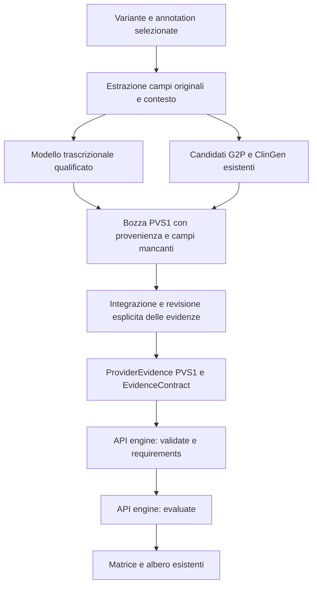

# Progetto dell’adapter PVS1

Stato: **progettazione**, 2026-10-26. Nessun evaluator, endpoint o comportamento
di produzione viene aggiunto da questo documento. Requisiti verificati sul
codice locale di ACMG Engine Task 22 e sulle sorgenti attive di HELPER.

## Obiettivo e primo perimetro

Costruire un’evidenza `PVS1` per **una variante e un trascritto esplicitamente
selezionati**, conservando originali, fonti, trasformazioni e dati mancanti.
Il primo caso completo sarà una variante nonsense; seguirà frameshift solo
quando sia disponibile la posizione validata del nuovo stop. Splicing,
start-loss e varianti strutturali avranno requisiti e percorsi separati.

L’adapter prepara osservazioni. ACMG Engine continua a calcolare NMD, peso
dell’evidenza LoF, perdita proteica, applicabilità, stato e strength. HELPER non
applica soglie PVS1 né sceglie automaticamente il trascritto con forza maggiore.

## Requisiti effettivi del contratto

Il [catalogo dell’engine](../../acmg-engine/src/acmg_engine/resources/evidence_requirements_v1.json)
richiede contesto `gene`, `disease`, `gene_disease` e un envelope
`ProviderEvidence` con `value.kind = "PVS1"`. Il modello
[PVS1Observation](../../acmg-engine/src/acmg_engine/domain/pvs1.py) contiene:

- `variant_identity` coerente con l’allele selezionato e lo stesso assembly;
- `mechanism`, un `MechanismAssessment` per gene, malattia ed ereditarietà;
- `transcript_effects`, con `PVS1Transcript` e `MolecularConsequence`, oppure
  `structural` per il ramo strutturale.

Il catalogo iniziale non elenca tutti i campi necessari a completare un ramo.
La Requirements API e gli alberi eseguibili restano la fonte dei requisiti
progressivi. Un oggetto che supera lo schema può ancora essere insufficiente
per la valutazione scientifica.

## Cosa HELPER possiede già

| Dato | Risorsa verificata | Riutilizzo proposto | Limite attuale |
| --- | --- | --- | --- |
| Allele, posizione, assembly, ALT selezionato | `helper_variants.indexer`, dettaglio variante | Copia dell’identità normalizzata; controllo REF con il verificatore FASTA esistente | FASTA e `.fai` devono essere disponibili per l’assembly corretto |
| Annotazione per allele e trascritto | `annotations[].metadata.fields`, originale ANN/CSQ e header | Leggere la sola annotation selezionata, preservando record e layout | La presenza dei singoli campi dipende dal VCF; non recuperarli da un altro ALT o trascritto |
| Gene e accession/versione del trascritto | HGNC/Gene/Feature/Feature_ID/Transcript | Identificativi stabili e versione originale | Versione non sempre presente; nessuna versione inventata |
| Consequence, HGVSc e HGVSp | Colonne normalizzate e campi originali VEP | Categoria molecolare candidata e HGVS originali | Annotazione non equivale a conseguenza verificata o a PTC validato |
| Strand, numero esone, posizioni cDNA/CDS/proteina, biotipo, canonical/MANE | Eventuali campi ANN/CSQ conservati integralmente | Estrazione condizionale, con tipo, unità e provenienza | Non è verificata la loro presenza nei VCF dell’utente; non descrivono necessariamente tutti gli esoni o un CDS completo |
| Associazione gene–malattia, validità ed ereditarietà | Cache GenCC e `acmg_context.py` | Riutilizzare l’associazione esatta selezionata e le sue fonti | La validità dell’associazione non stabilisce da sola il meccanismo LoF |
| Meccanismo molecolare e record di supporto | Cache Gene2Phenotype, `molecular_mechanism.records` | Presentare candidati per `MechanismAssessment`, con record, confidence, requisito allelico, pubblicazioni e data | Questi dati non sono trasferiti oggi nel payload ACMG; il riepilogo non è una curazione PVS1 |
| Haploinsufficiency/triplosensitivity e riferimenti | Cache ClinGen Dosage Sensitivity | Allegare supporto contestuale da revisionare | Dato spesso a livello di gene; richiede identità e contesto malattia compatibili |
| Constraint LoF, pLI/LOEUF | Cache gnomAD constraint | Informazione di supporto ispezionabile | Non imposta automaticamente `lof_established`, peso LoF o strength |
| Esistenti liste di trascritti, pannelli e BED target | Registro pannelli | Aiuto alla selezione e rintracciamento delle risorse | Inclusione nel pannello/cattura non prova rilevanza clinica; BED target non è un modello trascrizionale completo |
| Coordinate esoniche e strand | `files/All_genes_all_stranscripts_exons_info.txt` e asset `cnv.exons_info` | Possibile sorgente tecnica dopo qualificazione | Il file esaminato non dichiara assembly, release, versioni transcript o CDS nel formato |

Verifica leggera dei soli metadati della cache locale: schema 4, snapshot del
2026-10-21, 30.345 assertion GenCC, 3.856 record G2P, 1.537 record dosage e 10
record constraint. La cache risultava pronta e non scaduta secondo HELPER.
Questi conteggi non dimostrano che esista un record per una determinata coppia
gene–malattia, né che sia una fonte scientificamente qualificata per PVS1.
Non sono stati letti dati di pazienti o scaricati dataset.

La traccia RefSeq già configurata in IGV è una risorsa di visualizzazione
remota, non un provider backend versionato già pronto per l’adapter.

## Primo payload: campi e responsabilità

| Destinazione nell’evidenza PVS1 | Dato essenziale | Come ottenerlo |
| --- | --- | --- |
| `observation.variant_identity` | Assembly, cromosoma, posizione, REF/ALT | HELPER, già disponibile dopo verifica della reference |
| `observation.mechanism.gene/disease/inheritance` | Contesto esatto | Selezione HELPER, con disambiguazione esplicita |
| `observation.mechanism.mechanisms` | Categoria del meccanismo | Candidato G2P con fonte; conferma contestuale del revisore |
| `observation.mechanism.lof_established` | Valutazione YES/NO/UNKNOWN/CONFLICTING | Curazione documentata; non conversione automatica da score HI/constraint/confidence |
| `observation.mechanism.basis` e campi collegati | Base e peso dell’evidenza LoF | Vedi sezione successiva; dati curati attualmente incompleti |
| `transcript_effects[0].transcript` | ID/versione, gene, assembly, cromosoma, strand, esoni completi in ordine trascrizionale, CDS | Provider trascrizionale qualificato; alcune informazioni possono già provenire da ANN/CSQ |
| `transcript.clinical_relevance` e `affected_exon_relevant` | Rilevanza del trascritto e dell’esone | Fonte curata/attestazione esperta; canonical o MANE sono candidati documentali, non una conferma automatica |
| `transcript.alternative_rescue` | Valutazione delle isoforme/rescue | Curazione esplicita; assenza di annotazioni non significa ABSENT |
| `consequence.kind` | NONSENSE o FRAMESHIFT inizialmente | Conversione lessicale di consequence non ambigue, conservando l’originale |
| `consequence.ptc_mrna_position` e `downstream_stop_validated` | Prima base dello stop prematuro sullo specifico mRNA, con validazione | Annotazione/record strutturato validato o integrazione esperta; non disponibili dal solo nome della consequence |
| Provenance di evidenza, meccanismo, trascritto e conseguenza | Fonti, versioni, riferimenti, acquisizione e revisione | Riutilizzo dei dati di fonte più nuove attestazioni esplicite dove richieste |

Per il ramo ClinGen con NMD previsto, questi dati consentono di arrivare alla
valutazione del motore senza dover compilare preventivamente tutte le sezioni
opzionali. Se NMD non è previsto, l’albero può chiedere regione proteica,
criticità, numero di residui persi e lunghezza proteica. RNA, start alternativi e
struttura dei prodotti splice restano condizionali al ramo: non sono obbligatori
per ogni nonsense/frameshift.

### Peso del meccanismo: un requisito aggiuntivo importante

Il ramo ClinGen invoca il
[DiseaseMechanismEvaluator dell’engine](../../acmg-engine/src/acmg_engine/pvs1/disease_mechanism.py).
Anche `lof_established = YES` non completa questo passaggio. Il modello offre:

- `EXPERT_CURATED`: un esperto deve fornire il peso attraverso
  `expert_strength_downgrade` (0, 1 o 2), con motivazione e fonte revisionata.
  HELPER non sceglie né precompila tale valore.
- `TABLE_1_2018`: servono, secondo il ramo, validità dell’associazione,
  distribuzione delle varianti LoF sugli esoni, numero di varianti patogene
  indipendenti dall’uso di PVS1, quota fenotipica attribuita a LoF ed eventuale
  evidenza del modello animale. HELPER non possiede oggi questa curazione
  completa e non la ricostruisce contando etichette ClinVar.

Le soglie e la decisione fra i rami rimangono nell’engine. ACMG 2015 e ClinGen
General mantengono alberi distinti: non imporre i requisiti di peso/NMD ClinGen
come regola scientifica del protocollo storico.

## Dati che richiedono una nuova risorsa tecnica

1. **Modello trascrizionale versionato completo.** Preferire una sorgente locale
   indicizzata GTF/GFF3 o un’esportazione supportata della risorsa annotativa già
   usata da HELPER. Richiede assembly, release, accession/versione, schema delle
   coordinate, CDS/stop codon ed evidenza della completezza degli esoni. Non
   interpretare il formato interno della cache VEP senza un contratto verificato.
2. **Identità e metadati del file esonico esistente.** Prima del riuso servono
   assembly/release originali e una corrispondenza verificata con le versioni dei
   trascritti. Il solo header non è sufficiente. Contig patch e alias non vanno
   trasformati implicitamente in cromosomi principali.
3. **Stop prematuro validato.** Per frameshift la posizione della variante non è
   quella del nuovo stop; `Protein_position`, una lunghezza CDS o il parsing
   isolato di HGVSp non sostituiscono una ricostruzione validata. Riutilizzare
   l’annotatore esistente quando fornisce un risultato qualificabile; altrimenti
   mantenere il blocco e chiedere un record strutturato. Nessuna nuova pipeline
   VEP viene prevista in questo primo incremento.

Le coordinate dell’engine sono 1-based inclusive; il CDS di riferimento include
lo stop, la lunghezza proteica lo esclude. Il provider deve dichiarare tali
convenzioni e conservare ogni conversione tecnica. Questo vincolo va verificato
sulla sorgente, non dedotto dal suo nome o dall’assembly.

## Dati che richiedono curazione o attestazione

Servono ancora la conferma del meccanismo nella specifica malattia/ereditarietà,
il suo peso, la rilevanza di trascritto/esone, rescue e, quando raggiunti,
criticità della regione proteica e interpretazione degli esperimenti RNA.
Le fonti già presenti riducono l’inserimento manuale: il revisore deve poter
ispezionare e adottare un record esistente, senza ricopiarne i valori.

L’engine richiede quality PASS, fonti versionate/rintracciabili e attestazioni
VERIFIED per superare i gate corrispondenti; anche meccanismo, trascritto e
conseguenza hanno controlli propri di provenance. `HumanVerification` richiede
revisore, timestamp e motivazione. HELPER non deve impostare VERIFIED o PASS
perché un valore è stato copiato, un dataset è in cache o il VCF ha FILTER=PASS.
Revisione delle evidenze e revisione dell’esito del criterio sono azioni distinte:
confermare un risultato nella matrice non qualifica retroattivamente le fonti.

Nell’app attuale l’identità del revisore è una dichiarazione locale, non una
firma autenticata. L’interfaccia deve conservarne questa limitazione.

## Disegno del flusso e punti di modifica proposti

Componenti proposti, **non ancora implementati**:

- `core/acmg_pvs1.py`: estrazione dalla sola annotation selezionata, composizione
  della bozza e dell’envelope; nessun calcolo di status, NMD o strength.
- Un provider di struttura trascrizionale locale, in sola lettura, interrogato
  per assembly + accession/versione + release; fonte registrata e checksum
  riusato. Nessun download o nuova indicizzazione massiva durante la valutazione.
- Lettura dei record G2P originali nella cache esistente. Richiedere match
  verificabile di gene stabile, malattia e requisito allelico/ereditarietà.
  Il riepilogo corrente può includere fallback per simbolo: non adottarlo come
  prova di identità. Conservare i candidati in conflitto senza sceglierne uno.
- Estensione mirata di `acmg_context.py`/`acmg_workbench.py` per trasportare il
  contesto e le fonti PVS1 selezionate. Oggi il contesto normalizzato conserva
  gene/malattia/ereditarietà ma non il meccanismo G2P.
- Estensione di `acmg_task22.py`: il serializzatore automatico oggi ammette solo
  POPULATION/COMPUTATIONAL. Per PVS1 occorre rispettare la serializzazione
  canonica dell’envelope, conservando `received_json` e trasformazioni esplicite,
  con validazione remota e fixture reali. Non basta aggiungere `kind: PVS1`.
- Sezione PVS1 nel workspace esistente: dati già disponibili, fonti proposte,
  campi tecnici mancanti e valutazioni da revisionare; form tipizzati dai modelli
  reali. Non aggiungere un secondo viewer o una nuova matrice.

La bozza è un oggetto interno proposto di HELPER, non un nuovo contratto
dell’engine. Ogni campo deve indicare valore originale, valore mappato, source
record/release/checksum, eventuale trasformazione e motivo del blocco. Separare
il mapping tecnico dal readiness e dallo stato del criterio restituiti dall’API.
Non creare placeholder scientifici per riuscire a serializzare un oggetto.
Le valutazioni incomplete consentite dal contratto rimangono esplicitamente
incomplete; quelle non serializzabili restano una bozza locale.

Ogni integrazione/revisione genera una nuova versione di input e un nuovo
tentativo HELPER. Non modificare retroattivamente una valutazione salvata.

## Implementazione incrementale e verifica proposta

1. **Inventario PVS1 nel dettaglio variante.** Mostrare cosa è presente e cosa
   manca usando VCF, cache e fonti esistenti. Nessuna nuova attivazione PVS1.
2. **Qualificazione del provider trascrizionale.** Provare un trascritto singolo,
   versionato, nello stesso assembly; esoni completi e CDS coerente. Definire la
   provenienza dello stop validato prima di abilitare il percorso completo.
3. **Curazione assistita.** Proporre i record G2P/dosage esatti, raccogliere peso
   LoF, rilevanza e rescue con riferimenti e attestazioni esplicite.
4. **Primo caso nonsense completo.** Validare l’envelope tramite API, interrogare
   i requirements PVS1 e riusare evaluate/albero esistenti. Confrontare il payload
   e la trace con i modelli e le fixture reali Task 22.
5. **Frameshift e rami successivi.** Solo dopo verifica del caso precedente;
   richiedere un PTC downstream validato. Splice/start-loss/CNV avranno un proprio
   incremento; HELPER oggi rifiuta alleli VCF simbolici nel workspace ACMG.

Test futuri mirati: identità ALT/trascritto, assembly/versione in conflitto,
campi ANN/CSQ assenti o ambigui, struttura sullo strand negativo, coordinate
CDS/stop, candidate G2P discordanti, fonte non revisionata, mancata promozione
automatica di MANE/HI/constraint e immutabilità delle versioni. I risultati
scientifici attesi vengono dalle fixture dell’engine, non da un evaluator HELPER.
Non eseguire suite esaustive, annotazioni o pipeline pesanti senza chiedere prima.

## Decisioni ancora aperte

- Quale risorsa locale può fornire modello trascrizionale **e** metadati di release
  verificabili? Il file esonico esistente richiede qualificazione; una GTF/GFF3
  completa non è stata individuata né scaricata in questa analisi.
- Quale fonte fornisce la posizione validata del PTC per i VCF realmente usati?
  I default VEP richiedono HGVS/versione transcript, ma non garantiscono questo
  dato strutturato; va verificato su un’annotazione rappresentativa.
- Quale procedura di curazione produce le attestazioni richieste dall’engine?
  Il solo caricamento delle fonti G2P/ClinGen non soddisfa questi gate.

Con i dati attuali HELPER può già preparare identità, contesto, annotazioni e
candidati di meccanismo. Per un PVS1 completamente valutabile mancano soprattutto
modello trascrizionale qualificato, PTC validato e curazione delle evidenze.
