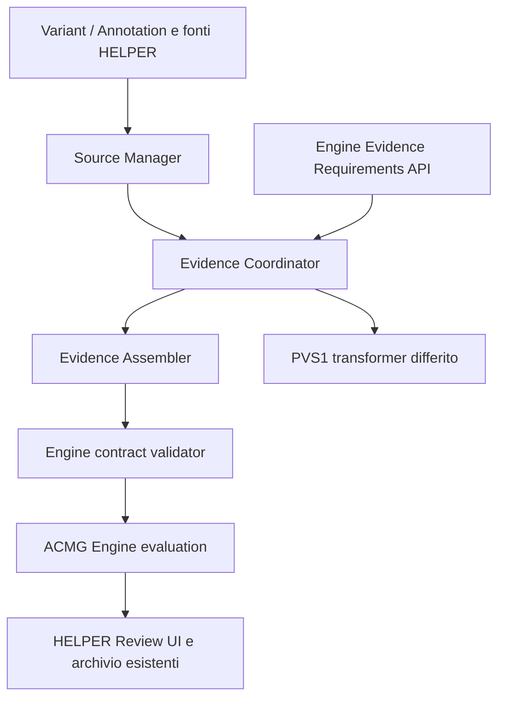

# Task 24 — Global Evidence Builder

Il builder estende il percorso Task 22 esistente. Lavora sul workspace preparato
da `acmg_workbench.prepare`, usando solo variante, ALT, annotation, trascritto e
contesto selezionati. ACMG Engine mantiene criteria evaluation, activation,
strength, decision trees e valutazione della sufficienza scientifica.

## Componenti e confini

| Componente | Implementazione | Input → output |
| --- | --- | --- |
| Source Manager | `core/acmg_sources.py`, `SourceManager` | Identità allele oppure gene stabile/simbolo → record della cache esistente, source ID, stato, release e timestamp disponibili |
| Evidence Coordinator | `core/acmg_evidence.py`, `EvidenceCoordinator.build` | Workspace immutabile, protocollo versionato, correzioni esistenti → contratto validato, requirements aggiornati, fonti richieste, missing ed eventuali errori |
| Evidence Assembler | `core/acmg_evidence.py`, `EvidenceAssembler` | Workspace arricchito e record originali → `EvidenceContract`/`ProviderEvidence` tramite serializzatori esistenti e validatore remoto |
| PVS1 futuro | `deferred_pvs1` | Annotation ID, candidati disponibili e node requirements PVS1 → handoff `DEFERRED`, senza evidenza scientifica inventata |

`SourceManager.catalog()` riusa `source_registry.catalog()` per la discovery
locale esplicita. Non viene chiamato per ogni variante. Gli accessi effettivi
sono su richiesta: il percorso Task 22 legge le cache locali; solo una chiamata
esplicita `population(..., fetch=True)` può invocare il client gnomAD esistente.
Non vengono eseguiti probe HTTP o sincronizzazioni delle fonti.

Gli stati sono `AVAILABLE` (accessor configurato, anche con cache miss), `CACHED`,
`STALE`, `UNREACHABLE` (fallimento di accesso osservato) ed `ERROR`. La cache
gene–malattia mantiene il proprio TTL. La cache delle frequenze gnomAD non ha un
TTL nel client esistente: la freschezza viene dichiarata `NOT_RECORDED`, senza
attribuirle una garanzia nuova. Questi stati non qualificano scientificamente
un'osservazione e non significano `AVAILABLE_VALID` dell'engine.

## Flusso operativo

1. La preparazione del workspace continua a usare `acmg_workbench.prepare`,
   `acmg_context`, `acmg_reference.verify` e gli adapter annotativi esistenti.
   Nessuna modifica a import VCF standalone, run o workflow Nextflow.
2. Il Coordinator copia il workspace e applica i guard esistenti su reference e
   versione del trascritto tramite `provider_contract`. Consulta
   `/v1/evidence/requirements` con variante, contesto e protocollo.
3. Le alternative richieste determinano l'accesso a Population e al contesto
   gene–malattia. Le osservazioni computational già estratte sono riutilizzate.
   I dati pubblici provengono dalle cache esistenti, senza cache aggiuntive.
4. `acmg_population.import_cached` conserva release, dataset, identità allele,
   counts, AF e coverage disponibili. Nessun conteggio è dedotto dall'assenza.
   Un record appartenente a un altro allele resta escluso e dichiarato mancante.
5. L'Assembler riusa `provider_contract`, `provider_envelope` e
   `canonical_import`. I record sorgente e i metadati pertinenti sono conservati
   in `received_json`; una trasformazione esplicita documenta il mapping fino
   al valore canonico. Le correzioni manuali conservano il proprio originale.
6. `/v1/evidence-contracts/validate` esegue la validazione autorevole, inclusi
   riferimenti, identità, versioni, provenance e semantica. Il builder restituisce
   errori strutturati; non implementa un secondo schema Pydantic. Lo schema di
   riferimento resta `../acmg-engine/docs/schemas/evidence-contract-1.0.json`.
7. Il Coordinator aggiorna i requirements con il contratto validato.
   Gli endpoint preflight/evaluate/compare esistenti usano questo percorso;
   preflight aggiunge `builder`, mentre evaluate/compare archiviano il relativo
   audit insieme all'input e al risultato. Le chiavi precedenti sono mantenute.
   L'evaluation scientifica continua a essere una chiamata separata dell'API.

## Fonti e rappresentazione

| Fonte riutilizzata | Dati trasferiti | Limiti conservati |
| --- | --- | --- |
| Variant/Annotation selezionate | Identità, consequence, HGVS, trascritto e campi originali ANN/CSQ/INFO pertinenti | Digest del VCF identifica l'artefatto locale; non una release scientifica dell'annotatore |
| REVEL / SpliceAI | Osservazioni `COMPUTATIONAL` già estratte da `prepare` | Versioni del predittore assenti restano null; vettori parziali restano parziali; nessun massimo SpliceAI o soglia calcolati |
| gnomAD genomes | `POPULATION` dall'adapter esistente | Release configurata per dataset, senza attestazione upstream; qualità dell'envelope `UNKNOWN`, provenance `UNVERIFIED` |
| GenCC | Assertion della coppia esatta con ID/versione, classificazione, ereditarietà e riferimenti | Nessuna selezione automatica di una classificazione o curazione del meccanismo |
| G2P | Record con gene stabile, malattia originale, meccanismo originale/normalizzato, requisito allelico, confidence, pubblicazioni e review date | Fallback per solo simbolo escluso come prova di identità; record discordanti conservati come candidati |
| ClinGen Dosage | HI/TS della malattia selezionata o alias attestato dall'associazione, ID gene originale, score e riferimenti | Equivalenza NCBI/HGNC non dimostrata resta `UNVERIFIED`; non stabilisce compatibilità del meccanismo |

I candidati gene–malattia attraversano il contratto tramite il modello
`EXTENSION` già disponibile nell'engine, con schema ID
`helper-gene-disease-candidates`, versione `1.0`. Ogni fonte ha un envelope:
`records_json` contiene contesto selezionato, record originali, URL e metadati di
snapshot; `mechanism_compatibility` è `NOT_VERIFIED`. Non sono convertiti in
`PVS1` o adottati come `context.gene_disease.mechanism`. Le release globali non
registrate restano null con limitazioni esplicite; le versioni individuali GenCC
e le date G2P/ClinGen rimangono nei record. Schema della cache e data di sync
non sono usati come release scientifiche. Una fonte senza candidati adeguati
genera un missing specifico.

Il recupero G2P riusa l'arricchimento delle associazioni GenCC dell'adapter
esistente: senza tale associazione non viene aggiunto un lookup G2P indipendente.

La sola estensione all'adapter gene–malattia conserva gli identificativi
gene/disease e il meccanismo originale già presenti nelle colonne G2P: non
modifica lo schema SQLite e non aggiunge un resolver.

## Precisione, dipendenze e isolamento

Il client gnomAD esistente calcola AF come divisione binary64 di AC/AN.
`population_rounding_tolerance` dichiara al validatore una tolleranza di due ULP
del quoziente atteso, calcolata con `Decimal` per il trasporto. Non usa la
discordanza osservata per allargare la tolleranza, non modifica AF e non assegna
tolleranze agli AF annotati nel VCF. Un errore reale AC/AN/AF rimane conflittuale.

`source_dependencies` registra esclusivamente gruppi con lo stesso source ID
e digest come `CORRELATED`, dopo le correzioni. Non crea `DERIVED_FROM` fra
predittori e non assume indipendenza scientifica. Le derivazioni interne a una
singola osservazione restano nella traccia delle trasformazioni.

Non esistono cache del Coordinator o dell'Assembler, né cache di contesto clinico
condivise. Le sole cache condivise restano quelle pubbliche già presenti.
Workspace e correzioni sono copiati; l'archivio conserva contratto e audit del
singolo tentativo. Compare costruisce un unico contratto riutilizzato dai due
protocolli; le build successive rileggono le cache esistenti. Un nuovo record
di cache non rietichetta un'osservazione del workspace con digest diverso.

## PVS1 e verifica

Il collegamento `deferred_pvs1` riusa l'annotation selezionata e i candidati del
builder comune. Riprende i requisiti progressivi dell'API e il progetto in
`TASK23_PVS1_ADAPTER_DESIGN.md`. Non ricostruisce CDS, frameshift o stop prematuri,
non calcola NMD e non assegna strength. Il prossimo incremento richiede un
provider trascrizionale qualificato e la curazione contestuale del meccanismo.

`helper_next/tests/test_acmg_evidence.py` usa fixture sintetiche, cache SQLite
temporanee e il validatore/Requirements service reali del repository engine in
un processo separato, preservando i runtime Pydantic dei due progetti. Nessun
accesso alle sorgenti esterne e nessun evaluator scientifico sono necessari.
Il test verifica anche lo schema portabile, il riuso tra protocolli, gli errori,
le dipendenze dopo sostituzioni manuali e gli endpoint Task 22 esistenti.
Il runtime engine è selezionabile con `HELPER_TEST_ENGINE_PYTHON`; in sua assenza
solo i test che lo richiedono sono saltati esplicitamente.
