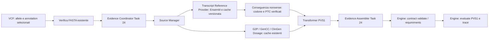

# Task 25 — Transcript evidence e nonsense PVS1

Il percorso Task 24 ora produce evidenza `PVS1` per l'annotation `stop_gained`
esplicitamente selezionata. HELPER verifica fatti molecolari e trasporta dati;
ACMG Engine conserva NMD, applicabilità, activation, strength e decision tree.
Il contratto rimane `evidence-contract-1.0`, senza nuovi modelli Pydantic locali.



## Sorgenti effettivamente utilizzate

* **Ensembl REST**, query di un solo trascritto: [lookup con expand/MANE](https://rest.ensembl.org/documentation/info/lookup),
  [sequenze cDNA/CDS/proteina](https://rest.ensembl.org/documentation/info/sequence_id),
  `/info/data` e `/xrefs/id/{gene}?external_db=HGNC`. GRCh38 usa
  `rest.ensembl.org`, GRCh37 `grch37.rest.ensembl.org`. Nessun database completo
  viene scaricato. ID/versione esatta e release configurata sono obbligatori;
  una versione diversa restituita dall'host non viene sostituita a quella VCF.
* **MANE**: metadati restituiti dal lookup Ensembl; accession RefSeq corrispondenti
  conservati, senza qualificare sequenze RefSeq attraverso una sostituzione.
  Non è implementato un provider diretto RefSeq. MANE non certifica rilevanza
  clinica, rilevanza dell'esone o assenza di rescue.
* **G2P, GenCC e ClinGen Dosage**: cache gene–malattia già presenti nel Task 24.
  G2P viene interrogato indipendentemente dalle assertion GenCC. Le selezioni
  richiedono gene stabile e malattia esatta oppure alias attestato; nessun match
  per solo simbolo viene adottato come prova di identità. Dosage mantiene
  l'equivalenza NCBI/HGNC non verificata come tale.

Il file esonico non qualificato di HELPER non viene letto.

## Provider e cache

`core/acmg_transcripts.py` recupera esoni completi, ordine trascrizionale,
strand, assembly, release, accession/versione, MANE, biotipo, estremi CDS sullo
mRNA, segmenti codificanti genomici, cDNA/CDS, proteina/lunghezza e giunzioni
con coordinate genomiche e mRNA. Le coordinate sono **1-based inclusive**.
Il CDS include lo stop; la proteina lo esclude.

La qualificazione controlla identità/specie, coordinate e assenza di overlap,
lunghezza cDNA/esoni, estremi Translation mappati sullo mRNA, corrispondenza
CDS/cDNA, divisibilità per tre, ATG iniziale, stop terminale e traduzione completa
uguale alla proteina recuperata. Gli estremi Translation del lookup Ensembl
sono verificati contro il CDS comprensivo di stop, come nel riferimento HBB.
Release prima e dopo il recupero devono coincidere con quella configurata.
Gli xref HGNC mancanti non invalidano l'identità Ensembl del gene, ma impediscono
di dimostrare un contesto HGNC attraverso quel riferimento.

La cache JSON pubblica è indicizzata da versione del provider + assembly +
accession/versione + release, con checksum SHA256 delle risposte originali,
URL e timestamp. Le scritture sono atomiche; ogni lettura ricontrolla checksum
e qualificazione. Nessuna cache di contesto clinico viene aggiunta. Una release
precedente resta utilizzabile offline se già acquisita; l'host live deve esporre
la release richiesta per un nuovo recupero.

Configurazione:

```bash
export HELPER_ENSEMBL_RELEASE=116
export HELPER_TRANSCRIPT_CACHE=/percorso/cache/pubblica/transcripts
# Facoltativo: consente query mirate durante il build; default offline.
export HELPER_TRANSCRIPT_FETCH=1
```

In alternativa preacquisire il singolo riferimento con
`TranscriptReferenceProvider().get("ENST00000335295.4", "GRCh38", fetch=True)`.
Senza cache/configurazione, il builder invia un'osservazione incompleta con
il motivo preciso; non avvia sincronizzazioni o scaricamenti massivi.

## Calcoli e dati PVS1

`core/acmg_pvs1.py` confronta assembly, cromosoma, trascritto/versione e gene
stabile. L'identità genomica arriva dal workspace verificato contro FASTA.
La variante deve mappare contiguamente nel CDS e REF deve corrispondere al cDNA,
con reverse complement sullo strand negativo. Sono supportate sostituzioni
di uguale lunghezza, incluse SNV; nessun calcolo frameshift.

La sostituzione nel CDS ricostruisce il primo stop in frame, che deve precedere
lo stop di riferimento. L'audit conserva REF/ALT orientati sul trascritto,
codone originale/alterato, posizione proteica e le seguenti formule versionate:

* `coding_position = allele_mRNA_start - CDS_start + 1`;
* `PTC_mRNA = CDS_start + 3 × first_stop_index`, indice proteico zero-based;
* `distance_nt = junction_upstream_exon_mRNA_end - PTC_first_base`;
* `inclusive_tail_nt = distance_nt + 1`, convenzione inclusiva usata dall'engine.

Sono registrate la prossima giunzione e l'ultima giunzione downstream come fatti
geometrici. Se il PTC è nell'esone terminale o il trascritto è mono-esonico,
giunzione downstream e distanze rimangono null. Nessuna soglia NMD viene applicata.
PTC, prima base del codone, viene anche rimappato sul genoma; un codone può
attraversare una giunzione senza assumere continuità genomica.

Il transformer emette `PVS1Observation` con identità, `TranscriptEffect`,
`PVS1Transcript`, `MolecularConsequence(kind=NONSENSE)` e conseguenza verificata.
Codoni, sequenze, segmenti e distanze non hanno nuovi campi nel contratto:
sono conservati nel `received_json` e nella trasformazione dell'envelope.
L'Assembler invia il risultato al validatore autorevole del motore e aggiorna
i requirements esistenti. Il normale endpoint evaluate continua a essere
responsabile della successiva chiamata scientifica.

Il meccanismo rimane `lof_established=UNKNOWN`, senza categorie adottate
automaticamente; con ereditarietà assente/ambigua, `mechanism=null`.
G2P conserva malattia originale, ID gene/malattia, meccanismo originale e
normalizzato, requisito allelico, confidence, pubblicazioni e date/versioni
disponibili. GenCC e Dosage conservano i record Task 24. Le divergenze G2P
restano visibili con flag di review; non vengono risolte. Release scientifiche
globali mancanti restano null, senza sostituirle con la data della cache.
Le stringhe HGVS originali vengono conservate senza normalizzazione indipendente.

## Caso pubblico e test

La fixture `tests/fixtures/task25/hbb_ensembl_116.json` conserva risposte pubbliche
di query mirate Ensembl, release **116**, trascritto **ENST00000335295.4**.
Il caso di sostituzione `GRCh38 11:5226774 G>A`, `c.118C>T`, produce:

| Dato | Valore ricostruito |
| --- | --- |
| Strand | negativo |
| Codone | CAG → TAG |
| PTC mRNA / genomico | 168 / 5226774 |
| Posizione proteica | 40 |
| Ultima giunzione mRNA | 365 |
| Offset / distanza inclusiva | 197 / 198 nt |

Gli xref HGNC del caso pubblico hanno avuto timeout upstream: la fixture non
inventa l'equivalenza e usa il gene Ensembl. Malattia/ereditarietà del test sono
sintetiche e non attestano una relazione clinica di HBB.

`tests/test_acmg_pvs1.py` verifica entrambi gli strand, stop alla giunzione e
nell'esone terminale, identità/REF/assembly discordanti, assenza di trascritto o
CDS, release/versioni errate, integrità/cache offline, conflitti G2P e malattia
G2P senza GenCC. VCF sintetici attraversano indexer, prepare, Source Manager,
provider, Coordinator e Assembler, validati dal contratto reale del motore.
Il caso pubblico attraversa anche il servizio scientifico reale in un processo
separato, per ACMG 2015 e ClinGen General: nessuna strength viene assegnata in
assenza di review sufficiente. Il runtime viene riusato dal repository engine
adiacente; nessuna dipendenza o configurazione di servizio viene modificata.

Comando mirato:

```bash
PYTHONPATH=helper_next/src python -m pytest -q \
  helper_next/tests/test_acmg_pvs1.py helper_next/tests/test_acmg_evidence.py \
  helper_next/tests/test_acmg_task22.py helper_next/tests/test_gene_phenotype.py
```

Il test REST aggiuntivo si abilita con `HELPER_TEST_TASK25_SERVICE=1` quando
l'engine è già in esecuzione. Il probe locale a `127.0.0.1:8000/health` ha
restituito connessione rifiutata: test REST non eseguito, servizio non avviato.
Nessun dato paziente, test massivo o pipeline annotativa è stato utilizzato.

Risultato della verifica mirata: **59 test passati, 5 saltati** (test REST opt-in
Task 22/25); `git diff --check` senza errori. Rimane il warning preesistente di
Starlette su `python_multipart`.

## Informazioni mancanti e limiti

Restano da revisionare meccanismo gene–malattia/ereditarietà e relativo peso,
rilevanza clinica del trascritto/esone, alternative rescue, quality e attestazioni
umane. La base `TABLE_1_2018` nel record incompleto è il default di trasporto del
contratto, non una curazione effettuata da HELPER. I conteggi e gli assessment
clinici mancanti restano null/UNKNOWN. I requirements progressivi dell'engine
restano autorevoli per i campi condizionali, inclusa la regione proteica.

Sono esclusi RefSeq diretto, contig non primari/mitocondriali, codici genetici
speciali, CDS parziali o sequenze ambigue, frameshift, splice, CNV, start-loss,
analisi RNA e letteratura automatica. Il provider non cerca automaticamente
versioni storiche in altri archivi. Non vengono aggiunti UI, database o servizi.
Rimane il guard Task 22: una annotation VCF senza versione del trascritto viene
bloccata con `TRANSCRIPT_VERSION_REQUIRED` prima dell'assemblaggio, senza
inventare una versione o un PTC.
Il prossimo incremento consigliato è la curazione esplicita e tracciata delle
evidenze PVS1 già raccolte, attraverso il percorso di correzioni esistente.
