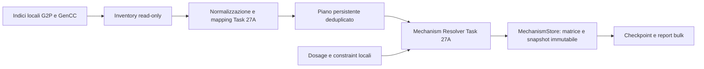

# Task 27A.1 — Bulk population della Mechanism Evidence Cache

Stato: implementato e verificato. Eseguiti dry-run e prova offline su **20**
associazioni reali. **Il popolamento completo non è stato avviato.** Nessun commit.

**Policy corrente Task 27A.2:** registro ontologico usato sia dal bulk sia dal
resolver; 15.577 associazioni, 3.387 condivise. Il precedente NO-GO scientifico
è superato dal GO conservativo documentato in
[TASK27A2_ONTOLOGY_MAPPING_REGISTRY.md](TASK27A2_ONTOLOGY_MAPPING_REGISTRY.md).
I conteggi e le policy sotto riportati sono storici quando differenti. I vecchi
job 1.x non sono riprendibili con la policy 2.0; lo storico rimane disponibile.

**Aggiornamento audit pre-popolamento:** i conteggi e il pilot originali in questo
documento sono storici. Il normalizzatore 1.1 applica il crosswalk G2P/HPO
documentato: 15.590 associazioni, 3.374 condivise. Il giudizio di quell'audit era **NO-GO**
per il popolamento completo; vedere [audit](TASK27A1_PREPOPULATION_AUDIT.md).
Le nuove versioni invalidano la ripresa del piano 1.0: non usare il precedente
comando di popolamento completo prima di chiudere i problemi ontologici.

## Componenti riutilizzate e flusso

Gli indici pubblici già sincronizzati sono in
`helper_variants.gene_phenotype`, SQLite schema 4:

* `g2p_records`: record G2P indipendenti da GenCC;
* `assertions`: GenCC nel formato corrente `sgc_id/version_number`;
* `orpha_aliases`: mapping esatti già importati;
* `clingen_dosage` e `gnomad_constraints`: contesto pubblico già disponibile.

Task 27A esponeva letture per gene, ma non un'enumerazione completa. È stato
aggiunto un accessor **read-only** alle medesime tabelle, senza nuovi parser,
download o adapter esterni. Il Source Manager continua a essere quello esistente.



File direttamente coinvolti:

| File | Funzione |
| --- | --- |
| `helper_next/acmg_mechanisms_bulk.py` | CLI, validazione opzioni, report umano/JSON ed exit code |
| `core/acmg_mechanisms_bulk.py` | Inventario, deduplicazione, selezione incrementale, esecuzione e ripresa |
| `core/acmg_sources.py` | Enumerazione tramite Source Manager; override locale dei fetch per `--offline` |
| `helper_variants/gene_phenotype.py` | Lettura consistente delle righe dagli indici esistenti, con SQLite `mode=ro` |
| `core/acmg_mechanisms.py` | Stato tecnico read-only e opzione di ricostruzione dal source state corrente |
| `core/acmg_mechanism_store.py` | Migrazione v2, journal bulk, lease e conteggio atomico delle pubblicazioni |
| `tests/test_acmg_mechanisms_bulk.py` | Fixture sintetiche e test di lifecycle, CLI e persistenza |

Non sono state modificate regole PVS1, strength, stati di review o logiche di
riconciliazione scientifica. Ogni matrice viene prodotta dal resolver e salvata
dal suo `publish`; il bulk non inserisce direttamente evidenze o snapshot.

## Enumerazione, identità e deduplicazione

Il reader acquisisce una vista consistente dei dati locali. Il preflight
richiede schema atteso, entrambe le tabelle G2P/GenCC, URL di import registrate,
timestamp di sincronizzazione interpretabile e contenuto non vuoto. Una fonte
assente/non sincronizzata, un indice vuoto o incompatibile impediscono la
popolazione; anche il dry-run riporta `PREFLIGHT_FAILED`.

Un indice già sincronizzato ma vecchio può essere usato offline: rimane
esplicitamente `STALE`, senza presentare la rilettura come aggiornamento remoto.
La completezza del download upstream non è attestabile con i metadati legacy:
il report dichiara sempre `SYNCHRONIZED_LOCAL_INDEX_ONLY` e
`global_dataset_completeness=NOT_ATTESTED`.

Le associazioni richiedono HGNC e disease ID validi. Si riusano `curie`,
`allelic`, `identity` e `mapping` del Task 27A. I record senza identificativi
sufficienti sono esclusi con conteggio, motivo ed esempi di source record ID.
Il nome della malattia non genera un'identità.

Si deduplicano le chiavi gene + malattia equivalente + requisito allelico.
Le equivalenze sono esclusivamente i cross-reference attestati nei record e
i mapping esatti dell'indice già importato. All'interno di una componente non
ambigua si preferisce MONDO, poi OMIM, ORPHA e altri ID. Una componente con più
identificativi della stessa ontologia mantiene distinte le malattie primarie.
Dal normalizzatore 1.1, i termini **qualificati** G2P sono allineati ai termini
ereditari HPO secondo il crosswalk pubblicato; per esempio
`monoallelic_autosomal` corrisponde ad AD. Monoallelic/biallelic generici e X-linked
non qualificato restano separati, così come requisiti differenti.
Il valore originale del requisito viene passato al resolver, conservando anche
vocaboli complessi non convertibili in una categoria standard.

Dosage e constraint attraversano il Source Manager e il resolver esistenti.
HI/TS e LOEUF rimangono contesto; non attivano PVS1. Un cache miss gnomAD non
diventa zero, assenza biologica di constraint o esclusione di LoF. Il lookup
ClinVar gene–malattia resta `NOT_SUPPORTED`, come nel Task 27A.

## Comandi

Dalla radice `/home/jarvis/git/Helper`, con il runtime già presente:

```bash
# Enumerazione completa, nessuna scrittura nella cache o negli indici.
PYTHONPATH=helper_next/src python -m helper_next.acmg_mechanisms_bulk --dry-run --offline

# Prova limitata: salva al massimo 20 matrici e conserva il resto del piano.
PYTHONPATH=helper_next/src python -m helper_next.acmg_mechanisms_bulk --populate --offline --limit 20

# Statistiche e avanzamento: sola lettura, nessuna creazione/migrazione del DB.
PYTHONPATH=helper_next/src python -m helper_next.acmg_mechanisms_bulk --status

# Ripresa limitata di un job interrotto o limitato, con la medesima policy.
PYTHONPATH=helper_next/src python -m helper_next.acmg_mechanisms_bulk --populate --resume --offline --limit 20

# Aggiorna solo matrici esistenti obsolete; non crea quelle ancora mancanti.
PYTHONPATH=helper_next/src python -m helper_next.acmg_mechanisms_bulk --populate --refresh-stale --offline
```

Opzioni aggiuntive: `--source-db`, `--cache-db`, `--report file.json`, `--json`,
`--verbose`. I default riusano `HELPER_GENE_PHENOTYPE_DB` e `HELPER_MECHANISM_DB`.
`--report` scrive il report richiesto anche con dry-run; i database restano
invariati. Il report non può sovrascrivere uno dei database configurati.
Log dettagliati su stderr con `--verbose`; report su stdout.

`--offline` disabilita i fetch anche se `HELPER_MECHANISM_FETCH=1` nell'ambiente,
senza modificare configurazioni condivise. Il resolver può comunque rileggere
e aggiornare la cache a partire dagli indici locali. Senza `--offline` non viene
aggiunto alcun download G2P/GenCC: è possibile soltanto il fetch mirato gnomAD
già esistente, se precedentemente abilitato nella configurazione.

Exit code: 0 per esecuzione riuscita/limitata, 1 per errori sulle associazioni,
2 per preflight/configurazione/report non scrivibile, 3 per job concorrente
occupato, 130 per interruzione da tastiera.

## Persistenza, idempotenza e ripresa

Migrazione additiva del database MechanismStore **v1 → v2**, senza modificare
record sorgente o snapshot precedenti:

| Tabella aggiunta | Contenuto |
| --- | --- |
| `mechanism_bulk_runs` | ID job, fingerprint inventario, opzioni, stato, report iniziale e durata cumulativa |
| `mechanism_bulk_items` | Piano ordinato, chiave associativa, fingerprint input, tentativi, checkpoint, snapshot iniziale/finale ed esito |
| `mechanism_bulk_publications` | Collegamento fra job e snapshot effettivamente creati dal suo resolver |

Anche una prova con `--limit` registra il **piano completo**, ma elabora soltanto
il limite richiesto. Le righe di piano rimanenti non sono matrici e non avviano
valutazioni. `--resume` salta gli item `SUCCESS` e riprova quelli pendenti,
interrotti o in errore. Occorre mantenere le stesse opzioni `--offline` e
`--refresh-stale`. Un inventario cambiato richiede un nuovo `--populate` senza
`--resume`; il vecchio job rimane consultabile nel database.

Il collegamento job–nuovo snapshot viene scritto **nella transazione di
pubblicazione del resolver**. Se il processo si interrompe dopo il commit della
matrice ma prima del checkpoint dell'item, la ripresa rilegge il risultato e
non duplica lo snapshot. Il conteggio delle pubblicazioni non viene perso in
quella finestra. Un item in corso può quindi avere uno snapshot pubblicato ma
non ancora incluso nei contatori di matrici checkpointate, fino alla ripresa.

Si riusano i lease SQLite del Task 27A: un solo bulk per database, con rinnovo
durante l'elaborazione e lock per gene già gestiti dal resolver. Gli accessi API
ordinari possono continuare. Dopo una terminazione brutale il lease residuo
scade; la durata viene rinnovata ad almeno 300 secondi, adattata al timeout.
Un normale Ctrl-C rilascia il lease e marca il job `INTERRUPTED`.

I fingerprint associano record pertinenti, mapping, contesto dosage/constraint
e versioni del software alla specifica chiave. Un cambiamento in un'altra
associazione non forza una nuova matrice scientifica. Gli input immutati e
ancora freschi vengono riusati. La ricostruzione esplicita dal source state
corrente evita di conservare una seconda matrice vecchia quando un'altra
associazione dello stesso gene ha già aggiornato il source state condiviso.
Il resolver mantiene la propria selezione delle acquisizioni necessarie.

`--refresh-stale` usa scadenze/retry TTL, errori, versioni e fingerprint degli
input. La staleness upstream rimane visibile, mentre la rilettura segue il TTL
di retry già previsto dal resolver. Una seconda esecuzione con input invariati
riusa le matrici e crea zero nuovi snapshot. Non viene alterato lo storico.

## Significato del report

* `source_records`: record indicizzati G2P/GenCC, prima della deduplicazione;
* `source_associations`: chiavi valide per fonte prima della deduplicazione
  delle equivalenze fra fonti/ID;
* `normalized_source_associations` e `cross_source_associations`: cardinalità per
  fonte e intersezione dopo il mapping; la differenza fra somme non è presentata
  come sovrapposizione senza misurare l'intersezione;
* `unique_associations`: piano normalizzato complessivo;
* `processed`: associazioni tentate nel job; `processed_in_invocation` riguarda
  soltanto l'ultima invocazione;
* `matrices_saved`: associazioni checkpointate con matrice persistita verificata;
  `matrices_created/updated` distinguono il confronto col puntatore iniziale;
* `matrices_with_direct_assertion` e `matrices_context_only`: contenuto delle
  matrici, senza promozione clinica;
* `unresolved_associations`, `mapping_ambiguous`: condizioni che possono
  sovrapporsi ai conteggi precedenti;
* `sources_unavailable`: conteggi per matrice di cache miss, errori o sorgenti
  non supportate, separati da `errors` di elaborazione;
* `snapshots_created`: nuove pubblicazioni attribuite atomicamente al job;
* `dataset_versions`: release scientifiche realmente registrate, altrimenti null;
  le versioni individuali GenCC rimangono separate;
* `dataset_fingerprints`: hash SHA-256 delle proiezioni locali acquisite, con
  tabella, conteggio e scope; non sono hash dei download originali né release;
* `elapsed_seconds`: tempo cumulativo delle invocazioni concluse, inclusi
  inventario e ripresa. Non è una stima del tempo del popolamento completo.

`local_population_complete` rimane falso per un piano parziale, errori,
esclusioni prive di ID o una selezione limitata agli obsoleti. Anche quando
fosse vero, non attesterebbe la completezza globale dei dataset upstream.

## Disponibilità e prova reali

Verifica eseguita sugli indici locali del 21 ottobre 2026, ore **12:33:28 UTC**,
senza accessi remoti. SQLite sorgente schema 4, cache destinazione schema 2.

| Misura | Esito |
| --- | ---: |
| Record G2P locali | 3.856 |
| Assertion GenCC locali | 30.345 |
| Associazioni G2P valide prima della deduplicazione fra ID/fonti | 3.614 |
| Associazioni GenCC valide prima della deduplicazione fra ID/fonti | 15.350 |
| Associazioni uniche normalizzate | **18.957** |
| Record esclusi senza disease ID stabile | 232 |
| Associazioni con mapping ambiguo nell'inventario | 2.436 |
| Record Dosage / constraint presenti negli indici | 1.537 / 10 |

Il dry-run non ha creato il database e ha impiegato circa **11,16 s**.
La prova richiesta ha dato:

| Misura sul campione | Esito |
| --- | ---: |
| Associazioni processate / matrici nuove persistite | **20 / 20** |
| Matrici con assertion diretta | 4 |
| Matrici con sole evidenze contestuali | 16 |
| Associazioni irrisolte, incluse quelle con mapping ambiguo | 17 |
| Mapping ambiguo nel campione | 3 |
| Errori di elaborazione | **0** |
| Nuovi snapshot / record sorgente salvati | **20 / 37** |
| Associazioni restanti nel piano | **18.937** |
| Tempo totale, inventario incluso | circa **12,64 s** |

Sul campione: gnomAD `CACHE_MISS` per tutte le 20 matrici; ClinVar
`NOT_SUPPORTED` per tutte le 20. Nessun valore è stato inventato o recuperato
remotamente. I record Dosage disponibili sono stati mantenuti contestuali.
Le versioni scientifiche globali non sono registrate nell'indice e restano null;
le versioni individuali GenCC osservate nell'inventario sono 1, 2, 3, 4 e 5.
Audit: tutte le 20 review sono `NOT_REVIEWED`, zero violazioni di foreign key.

Cache effettiva:
`/home/jarvis/.local/share/helper_next/mechanisms.sqlite3`.
Job reale: `58398746bc884b73831d400c5b7d134f`, stato `LIMITED`.
Il [report completo del dry-run e del pilot](TASK27A1_BULK_POPULATION_REPORT.json)
conserva contatori, provenienza del piano, opzioni, limiti e audit.

## Comando per avviare il popolamento completo dopo la verifica

Il seguente comando **non è stato eseguito**. Riprende il job limitato già
salvato ed elabora le 18.937 associazioni restanti, con dati esclusivamente locali:

```bash
cd /home/jarvis/git/Helper
PYTHONPATH=helper_next/src python -m helper_next.acmg_mechanisms_bulk --populate --resume --offline
```

Se nel frattempo gli indici sono cambiati, creare un nuovo piano idempotente:

```bash
PYTHONPATH=helper_next/src python -m helper_next.acmg_mechanisms_bulk --populate --offline
```

## Test e limiti

22 test nuovi su dataset sintetici: deduplicazione attestata, separazione delle
eredità e delle malattie omonime, mapping ambiguo, dry-run senza scritture,
limit/resume, interruzione dopo commit, idempotenza, aggiornamento della sola
associazione modificata, ricostruzione di più matrici dello stesso gene,
refresh-stale, offline contro configurazione remota abilitata, fonti incomplete,
indici stale, errori riprovabili, concorrenza, migrazione v1 e CLI/report.

Verifica finale: **161 test passati, 0 falliti, 5 saltati**, inclusi i 139 test
precedenti dei moduli coinvolti. I cinque skip sono i test REST live opt-in
Task 22/25; il test HTTP locale Task 27A passa. Rimane il warning preesistente
Starlette relativo a `python_multipart`. `git diff --check` senza errori.

```bash
python -m pytest -q -o pythonpath=helper_next/src \
  helper_next/tests/test_acmg_mechanisms_bulk.py helper_next/tests/test_acmg_mechanisms.py \
  helper_next/tests/test_acmg_evidence.py helper_next/tests/test_acmg_pvs1.py \
  helper_next/tests/test_acmg_task22.py helper_next/tests/test_acmg_workbench.py \
  helper_next/tests/test_acmg_context.py helper_next/tests/test_gene_phenotype.py \
  helper_next/tests/test_gnomad_frequency.py helper_next/tests/test_clinvar.py \
  helper_next/tests/test_source_registry.py
```

Non vengono introdotti nuovi resolver ontologici o download. I limiti delle
fonti del Task 27A rimangono: release globali mancanti, mapping non dimostrati,
ClinVar non indicizzato per gene e constraint disponibile solo dove già acquisito.
Una matrice popolata automaticamente rimane un insieme di evidenze da rivedere,
non una valutazione clinica approvata.
