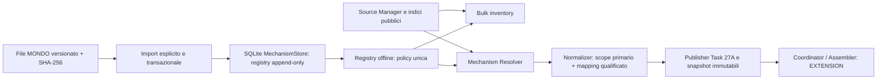

# Task 27A.2 — Ontology Mapping Registry e validazione runtime

Data: **27 ottobre 2026**. Esito: **GO al popolamento conservativo degli indici
locali validi**. Le identità non riconciliate restano isolate e consultabili;
non generano trasferimenti di assertion fra malattie. Il popolamento completo
**non è stato avviato**. Nessun commit, stato APPROVED, nuova logica ACMG,
strength o regola PVS1.

Report verificabile:
[TASK27A2_ONTOLOGY_MAPPING_REGISTRY_REPORT.json](TASK27A2_ONTOLOGY_MAPPING_REGISTRY_REPORT.json).
Il precedente audit NO-GO rimane conservato come risultato storico.

## 1. Architettura e modifiche



Componenti introdotti:

* `core/acmg_ontology.py`: registro, import, qualificazione, query e pin della
  release per richiesta/inventario;
* `helper_next/acmg_ontology.py`: CLI di caricamento e consultazione offline;
* `scripts/validate_ontology_registry.py`: confronto con la policy storica e
  pilot scientifico limitato a 70 query; non contiene una modalità full;
* `tests/test_acmg_ontology.py` e fixture pubbliche/sintetiche.

Modifiche circoscritte: Source Manager, normalizer, resolver, bulk inventory,
modello della matrice, MechanismStore, route di consultazione e documentazione.
Nessun nuovo servizio, database server, adapter G2P/GenCC o dipendenza installata.
Il registro usa **lo stesso SQLite** della Mechanism Evidence Cache; nelle
fixture può essere iniettato un registro separato. Nessun dato di pazienti.

## 2. Fonte e verifica del riferimento

Riferimento iniziale: MONDO **v2026-10-06**, già acquisito nell'audit:

[File SSSOM ufficiale versionato](https://raw.githubusercontent.com/monarch-initiative/mondo/v2026-10-06/src/ontology/mappings/mondo.sssom.tsv).

```text
SHA-256 ec15afdb32fab3d3cb679d357e25ef4fb38b5e2c468ff4ac5456da10e2f6c80b
```

Il caricamento verifica i byte **prima di aprire una transazione scrivibile**.
Un checksum errato non crea il database né cambia il registro attivo. Parsing,
registrazione delle righe e attivazione sono transazionali; le release
precedenti restano disponibili. L'import dello stesso contenuto è idempotente.

Sono memorizzate tutte le **109.802 righe** del riferimento:

| Stato delle righe importate | Numero |
| --- | ---: |
| VERIFIED_EXACT, entro la policy iniziale | 19.695 |
| AMBIGUOUS_MAPPING, cardinalità multipla | 137 |
| UNVERIFIED_CROSS_REFERENCE, altri namespace/predicati | 89.970 |

Questi sono conteggi di mapping, non di malattie indipendenti o associazioni
gene–malattia. I namespace non qualificati rimangono conservati nel raw record.

La [documentazione MONDO](https://mondo.monarchinitiative.org/pages/faq/) distingue
exact match ed equivalenza logica OWL: `VERIFIED_EXACT` qui qualifica uno scope
operativo ristretto, non dimostra identità logica completa o approvazione clinica.

## 3. Record del registro e qualificazione

Ogni mapping conserva ID deterministico, source/target identifier, predicato,
fonte, record sorgente, versione, fingerprint, verification status/basis,
conflict reason, valid_from/valid_until quando dichiarati, registry version e
policy version. Per MONDO il record è riferito alla riga dati del file versionato,
con la riga SSSOM originale completa. La data di acquisizione è nel manifest;
le date di validità assenti restano null.

Le osservazioni G2P/GenCC/Orphadata conservano anche source record ref, URL,
versione del record quando presente, raw payload e data di acquisizione. Il loro
fingerprint ha scope esplicito `GENE_SOURCE_RECORDS_WITH_INDEXED_MAPPINGS`, non
viene presentato come hash dei byte di un intero export. I fingerprint globali
delle proiezioni indicizzate rimangono nel report bulk.

Stati distinti:

| Stato | Significato |
| --- | --- |
| IDENTITY | stesso CURIE normalizzato; nessuna inferenza tra ontologie |
| VERIFIED_EXACT | equivalenza operativa qualificata dal riferimento attivo |
| UNVERIFIED_CROSS_REFERENCE | collegamento osservato senza qualificazione sufficiente |
| CONFLICTING_MAPPING | target dichiarato discordante dal riferimento fissato |
| AMBIGUOUS_MAPPING | più ID dello stesso namespace nella componente qualificata |
| NO_VERIFIED_MAPPING | nessuna equivalenza qualificata disponibile |

La policy `qualified-mondo-singleton-1.0` ammette inizialmente soltanto
`skos:exactMatch` espliciti **MONDO ↔ OMIM/ORPHA**, nella release verificata.
Una componente ammissibile contiene al massimo un ID per namespace: quindi
un solo MONDO ed eventualmente un solo OMIM e un solo ORPHA. Non si sceglie un
canonico comune in componenti con target multipli, neppure se la fonte li
considera proxy merge o exact match. In quelle componenti si mantiene ogni ID.

Il canonico condiviso viene scelto soltanto dopo la qualificazione; la priorità
è MONDO, poi OMIM, poi ORPHA. La coassegnazione nello stesso record non basta.
I collegamenti Orphadata, anche etichettati E, non costruiscono il grafo runtime.
Broad/narrow/related match non vengono promossi. Quando un link Orphadata non
exact tocca due ID riconciliati indipendentemente da MONDO, il link originario
rimane comunque non verificato con il proprio predicato.

`CONFLICTING_MAPPING` riguarda la **dichiarazione di mapping**, non dimostra
malattie biologicamente differenti. Mancanza di mapping, discordanza della
fonte, assenza di associazione e conflitto di meccanismo rimangono distinti.

## 4. Policy unica per bulk e runtime

Entrambi chiamano il medesimo `OntologyMappingRegistry`: non esiste una seconda
policy di equivalenza nell'enumeratore. Il grafo della policy ritirata è
ricostruito soltanto nello script di confronto storico, senza uso runtime.

La matrice usa l'ID primario originale del record come ancora dell'assertion:
`disease_curie`, altrimenti OMIM/disease_original_curie disponibile. Un'altra
malattia può riceverla soltanto se quell'ID primario è IDENTICAL/VERIFIED_EXACT
nella release qualificata. Un ID secondario coassegnato non qualificato può
comparire come contesto irrisolto, senza supportare un candidato LoF/GoF/DN.
Gli ID e tutti i campi originali rimangono nel raw payload e nell'evidenza.

I mapping scartati pertinenti alla query sono inclusi in `mapping_evidence`
con stato, motivo e provenance e vengono registrati dal publisher esistente.
`mapping_uncertainty` espone esplicitamente gli stati non risolti. Le issue
`CONFLICTING_DISEASE_MAPPING`, `UNVERIFIED_DISEASE_MAPPING` e
`NO_VERIFIED_DISEASE_MAPPING` sono separate da `CONTRADICTORY_ASSERTIONS`.

Le assertion direttamente pertinenti a un ID rimangono utilizzabili come
**candidate assertions**, anche quando quell'ID non ha alias verificabili.
Non diventano APPROVED: `review_status` resta `NOT_REVIEWED`.
Lo stesso vale per componenti ambigue, isolate sotto i rispettivi ID.

Il crosswalk ereditario qualificato del Task 27A.1 rimane invariato. AD/AR,
X-linked generico o qualificato, mono/biallelic generici e semidominant non si
fondono impropriamente. Non si usa la variante da classificare per dedurre
l'equivalenza o il meccanismo; il resolver non riceve un VCF.

Ogni operazione usa una view fissata della release. L'import concorrente non
mescola grafi nella stessa matrice. Il bulk rileva cambi del registro fra
item o durante la risoluzione e interrompe/rifiuta il piano incompatibile.
Un errore di refresh non ripropone come corrente una matrice con mapping ormai
incompatibili; gli snapshot storici restano accessibili esplicitamente.

## 5. SQLite, chiavi e compatibilità

Migrazione **additiva v2 → v3**, senza modificare l'indice gene–phenotype schema 4:

| Tabella nuova | Scopo |
| --- | --- |
| ontology_registry_releases | manifest immutabile per release/policy/fingerprint |
| ontology_mapping_records | mapping originali e osservazioni append-only |
| ontology_registry_current | puntatore alla release attiva |

Trigger vietano UPDATE/DELETE dei mapping e delle release. I mapping importati
hanno un hash verificato in lettura; source records e snapshot mantengono i
controlli di integrità già esistenti. Solo il puntatore attivo è aggiornabile.

Versioni operative:

* registry: `ontology-registry-1.0`;
* qualification policy: `qualified-mondo-singleton-1.0`;
* association/mapping policy: `registry-qualified-association-2.0`;
* bulk: `mechanism-bulk-2.0`;
* normalizzazione lessicale/ereditaria: 1.1, invariata rispetto all'audit.

La nuova association key include la policy, quindi non sovrascrive né riusa
le chiavi storiche 1.x. Equivalenze qualificate usano invece lo stesso canonico,
la stessa chiave corrente e lo stesso snapshot, a parità di scope e input.
Il manifest del registro entra nella provenance, nel digest scientifico e nei
fingerprint bulk; una release diversa invalida la matrice e il piano precedenti.
Un nuovo piano è necessario anche a dati locali invariati se cambia la policy.

Strategia conservativa: nessuna migrazione inferenziale delle vecchie matrici.
I vecchi puntatori e job rimangono nello storico; i nuovi puntatori vengono
costruiti separatamente. `--resume` su fingerprint incompatibili fallisce.
Il vecchio job LIMITED del pilot da 20 non deve essere ripreso con questa policy.

Gli snapshot vecchi conservano bytes, hash e chiavi. Il nuovo campo additivo
`mapping_uncertainty` non altera la verifica dei loro digest originali. Il
replay `SNAPSHOT` valida gene, disease ID/alias storico e scope, senza applicare
retroattivamente la nuova canonicalizzazione. Un replay storico è una
consultazione della policy precedente, non una nuova validazione del mapping.

## 6. Nuovo inventario reale

Dry-run offline sugli stessi indici locali dell'audit, senza nuove acquisizioni
G2P/GenCC:

| Misura | Audit 27A.1 | Task 27A.2 |
| --- | ---: | ---: |
| Associazioni G2P | 3.614 | 3.614 |
| Associazioni GenCC | 15.350 | 15.350 |
| Intersezioni | 3.374 | **3.387** |
| Associazioni uniche | 15.590 | **15.577** |
| Componente ambigua della chiave | 2.031 | **90** |

**3 gruppi prima accorpati sono separati**, mentre **16 gruppi ricevono una
nuova riconciliazione verificata**. Il saldo è −13 associazioni/+13 intersezioni;
non viene usato come indicatore autonomo di correttezza.

Classificazione delle chiavi correnti:

* **13.029** con componente VERIFIED_EXACT;
* **2.458** senza mapping verificato, conservate sotto il proprio ID;
* **90** in componenti AMBIGUOUS_MAPPING, conservate senza alias comuni.

Link scartati/da rivedere compaiono in 1.688 associazioni come conflicting,
1.503 come unverified e 112 come ambiguous. Questi conteggi **si sovrappongono**:
una chiave ben qualificata può avere anche un cross-reference originario
scartato verso un altro ID. Non sono conteggi di conflitti biologici o di LoF.

Le **232 righe G2P prive di disease ID** rimangono escluse e segnalate; non si
inventano identità dai nomi. La completezza è riferita agli indici locali e
agli identificativi validi, non a ogni dato possibile upstream.

## 7. Casi scientifici e pilot

Pilot offline separato: **38 query, 35 matrici uniche**, su HOXA1, NEU1, PEX6,
FLNA, MYH7, MYBPC3, LMNA e GLA. Le query ad alias verificati non duplicano matrici.
**205 occorrenze di record** sono state confrontate campo per campo con gli
originali dell'indice; le righe ripetute non sono osservazioni indipendenti.

| Caso | Comportamento verificato |
| --- | --- |
| HOXA1/G2P00123, OMIM:601536 | LoF pertinente a MONDO:7770750; nessun trasferimento a MONDO:0011099 |
| NEU1/G2P00573, OMIM:256550 | LoF direttamente pertinente a OMIM:256550; componente con due OMIM isolata; nessun trasferimento a MONDO:0009738 |
| PEX6/G2P03626, OMIM:616617 | Scope qualificato MONDO:0100263; meccanismo originale undetermined; nessun trasferimento a MONDO:0014709 |
| FLNA/G2P00850 | MONDO:0019027 e OMIM:304120 non vengono trattati come equivalenti; quest'ultimo è nel riferimento di MONDO:0010571 |
| MYBPC3 | LoF nello scope AD pertinente; nessuna propagazione ad AR |
| LMNA, MONDO:0030781 | GoF in AD e LoF in AR restano separati |
| GLA | XR qualificato distinto da X-linked generico |
| MYH7 | undetermined conservato; nessuna inferenza dal nome del gene o dalla cardiomiopatia |

Passano tutti e quattro i controlli negativi critici. Le fixture riproducono
le componenti complete pertinenti del riferimento ufficiale e i record pubblici.
Per i record realmente undetermined sono aggiunti **controfattuali sintetici**
con LoF: il test negativo non passa soltanto perché manca un meccanismo noto.
Nessun controfattuale modifica gli indici o viene pubblicato come dato reale.

Verificate anche **10 risposte API G2P mirate**, comprese quelle dei quattro casi
critici: zero differenze nei campi controllati rispetto agli indici. Le
acquisizioni, gli URL e gli hash sono nel report; non costituiscono una nuova
sincronizzazione completa. GenCC è verificato contro le righe e le versioni
originali del proprio export indicizzato, senza download completo aggiuntivo.

Il pilot ha creato 35 snapshot; il replay crea **0 snapshot aggiuntivi**.
I **20 snapshot storici** copiati dalla cache ordinaria restano byte-identici,
con replay esplicito e foreign key check riusciti. Il registro è stato poi
caricato nella cache ordinaria mantenendo 20 matrici/20 snapshot e 37 source
records: nessuna nuova associazione scientifica è stata popolata lì.

## 8. Test e regressioni

**207 passed, 5 skipped**, nessun fallimento. I cinque skip sono test REST
esterni opt-in già presenti. Passano il test HTTP locale e il confronto con
l'engine reale sui criteri/protocolli previsti, senza modifiche PVS1 o ACMG.
Il test HTTP usa l'esecuzione fuori dal sandbox già necessaria nell'ambiente.
Warning preesistente Starlette su `python_multipart`.

I 26 casi del nuovo modulo coprono checksum, predicati non exact, namespace
non qualificati, persistenza e immutabilità, cardinalità, pin delle release,
identità mancante, conflitti, no-transfer, separazione ereditaria, deduplicazione,
invalidation e source failure, replay storico v2→v3, ripresa di vecchi job,
concorrenza import/bulk e i quattro casi reali critici.

Comando della regressione mirata:

```bash
python -m pytest -q -o pythonpath=helper_next/src \
  helper_next/tests/test_acmg_ontology.py \
  helper_next/tests/test_acmg_mechanisms_audit.py \
  helper_next/tests/test_acmg_mechanisms_bulk.py \
  helper_next/tests/test_acmg_mechanisms.py \
  helper_next/tests/test_acmg_evidence.py helper_next/tests/test_acmg_pvs1.py \
  helper_next/tests/test_acmg_task22.py helper_next/tests/test_acmg_workbench.py \
  helper_next/tests/test_acmg_context.py helper_next/tests/test_gene_phenotype.py \
  helper_next/tests/test_gnomad_frequency.py helper_next/tests/test_clinvar.py \
  helper_next/tests/test_source_registry.py
```

Nessuna suite massiva, pipeline Nextflow, analisi di pazienti o modifica
all'ambiente delle dipendenze. Gli interventi Nextflow già presenti nel working
tree sono estranei a questo task e non sono stati modificati.

## 9. Accesso e comandi

Dalla radice del repository, con `PYTHONPATH=helper_next/src`:

```bash
# Import esplicito, offline, già eseguito sulla cache ordinaria.
python -m helper_next.acmg_ontology \
  --load-mondo /tmp/task27a1-audit/mondo-v2026-10-06.sssom.tsv

# Manifest attivo e consultazione, senza scritture o richieste HTTP.
python -m helper_next.acmg_ontology --status
python -m helper_next.acmg_ontology --lookup OMIM:256550

# Nuovo inventario corrente: non popola la cache.
python -m helper_next.acmg_mechanisms_bulk --dry-run --offline
```

Per un database alternativo usare lo stesso `--cache-db /percorso/cache.sqlite3`
sia nel caricamento del registro sia nel bulk, oppure `HELPER_MECHANISM_DB`.
Se il registro non è disponibile, il sistema usa **solo identità**, segnala il
limite e impedisce propagazioni da cross-reference; la valutazione non richiede
mai accesso remoto. Nessun download automatico del riferimento.

Consultazione API additiva: `GET /api/acmg/mechanisms/ontology` per il manifest,
oppure `?identifier=OMIM:256550` per i mapping. Resolve/snapshots/source-records
Task 27A rimangono disponibili; non sono introdotte API di approvazione.

Riproduzione del pilot e del confronto in un DB separato:

```bash
PYTHONPATH=helper_next/src python scripts/validate_ontology_registry.py \
  --reference /tmp/task27a1-audit/mondo-v2026-10-06.sssom.tsv \
  --pilot-db /tmp/task27a2-pilot.sqlite3 \
  --g2p-response-dir /tmp/task27a1-audit \
  --report /tmp/task27a2-validation.json
```

Il file di riferimento e le risposte sotto `/tmp` possono essere rimossi dal
sistema; il registro persistente non ne dipende dopo l'import. Le fixture e
il report nel repository conservano i casi e i risultati verificabili. Le date
di acquisizione dei file originali e la loro disponibilità non sono release
scientifiche inventate.

## 10. GO e limiti residui

**GO conservativo per le associazioni locali con identificativi validi.** I
mapping non risolti non sono eliminati o arbitrariamente riconciliati; restano
consultabili, con assertion direttamente pertinenti al proprio ID e link da
revisionare. È ammessa l'incertezza, non la propagazione impropria di meccanismi.

Restano fuori: namespace non qualificati, equivalenza logica OWL completa,
risoluzione automatica di proxy merge, review umana, source releases legacy non
registrate, gnomAD non acquisito, lookup ClinVar gene–malattia non supportato.
La semantica di tali assenze rimane esplicita. Non sono implementati Task 27B,
letteratura automatica, inferenze da classi di varianti, NMD o strength.

Quando si deciderà di avviare il popolamento, occorre un **nuovo piano**:

```bash
PYTHONPATH=helper_next/src python -m helper_next.acmg_mechanisms_bulk \
  --populate --offline --report /tmp/task27a2-full-population.json
```

**Questo comando completo non è stato eseguito.** Non aggiungere `--resume` per
riusare il vecchio job 1.x. I nuovi job potranno essere ripresi soltanto con le
stesse versioni e fingerprint compatibili.
