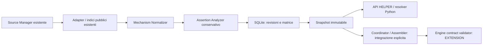

# Task 27A — Mechanism Evidence Cache

`TASK27A_IMPLEMENTATION_STATUS: COMPLETED`

Aggiornamento Task 27A.2: il mapping operativo è ora qualificato dal registro
ontologico persistente, schema SQLite 3; vedere
[TASK27A2_ONTOLOGY_MAPPING_REGISTRY.md](TASK27A2_ONTOLOGY_MAPPING_REGISTRY.md).
I riferimenti allo schema 1 nelle sezioni storiche descrivono il Task 27A iniziale.

## Obiettivo e confini

Cache pubblica, persistente e riproducibile delle assertions relative a
**gene + malattia + requisito allelico/ereditarietà**. Produce ipotesi dichiarate
dalle fonti, contesto e conflitti; non stabilisce il meccanismo clinicamente
validato, non approva evidenze e non attiva PVS1. Nessun nuovo servizio, account,
job obbligatorio, database server o dipendenza di produzione.

Il componente è implementato nel repository HELPER corrente e si collega
all'engine indipendente attraverso il contratto `EXTENSION` già esistente.
Non sono stati modificati il repository dell'engine, i suoi modelli scientifici,
le regole ACMG o i transformer PVS1 del Task 25.

## Mappa delle dipendenze riutilizzate

L'ispezione precedente alle modifiche ha identificato:

* `acmg_sources.SourceManager`: accesso centralizzato a fonti pubbliche;
* `helper_variants.gene_phenotype`: indice SQLite schema 4, import correnti
  GenCC (`sgc_id/version_number`), G2P, ClinGen Dosage e cache gnomAD constraint;
* `gene_phenotype`/`acmg_context`: CURIE, cross-reference G2P/GenCC, indice
  Orphadata con relazioni esatte; nessun confronto per somiglianza del nome;
* `helper_variants.clinvar`: enrichment/cache per allele, senza indice gene;
* `acmg_evidence`: Coordinator, Assembler, `received_json`, trasformazioni e
  validazione autorevole tramite l'engine Task 22;
* `acmg_pvs1` e `acmg_transcripts`: percorso nonsense Task 25, riutilizzato senza
  modificare valutazioni cliniche;
* `acmg_store`: archivio append-only di workspace, tentativi e review locali.
  Non viene riutilizzato per questa cache pubblica, per evitare di mescolare
  contesti clinici e riferimenti gene–malattia condivisi;
* configurazione tramite variabili `HELPER_*`, modelli Pydantic del runtime
  HELPER, logging strutturato e fixture sintetiche pytest già adottati.

Non esisteva un Mechanism Evidence Analyzer persistente. I documenti Task 22–25
e i relativi moduli costituiscono la base effettivamente presente; non sono
stati inventati moduli Task 19–21 mancanti nell'area ispezionata.

## Architettura e moduli



| File creato/modificato | Responsabilità |
| --- | --- |
| `core/acmg_mechanism_models.py` | Modelli tipizzati di identità, record, ipotesi, stato tecnico e risultato JSON |
| `core/acmg_mechanism_normalizer.py` | Normalizzazione lessicale, mapping attestato, separazione delle eredità, riconciliazione deterministica |
| `core/acmg_mechanism_store.py` | Schema SQLite v1, transazioni, revisioni append-only, lease, snapshot e confronto |
| `core/acmg_mechanisms.py` | Resolver lazy, policy TTL/refresh, invalidazione, fallback e logging |
| `core/acmg_sources.py` | Estensione del Source Manager esistente: lettura mirata e token di revisione dell'indice |
| `helper_variants/gene_phenotype.py` | Accessor additivo alle righe originali indicizzate; nessuna modifica a import, schema legacy o fetch gnomAD |
| `core/acmg_evidence.py` | Integrazione opzionale della matrice nel Coordinator/Assembler esistenti |
| `core/acmg_task22.py` | Ammissione del nuovo schema `EXTENSION` nel serializzatore esistente |
| `api/acmg_mechanisms.py` | Consultazione, snapshot, record originali e confronto; nessuna API di approvazione |
| `api/app.py`, `api/acmg_task22.py` | Registrazione route e parametri opzionali per preflight/evaluate/compare |
| `tests/test_acmg_mechanisms.py` | Test unitari, persistenza, concorrenza, API e confine engine reale |
| `docs/TASK27A_MECHANISM_MATRIX_EXAMPLE.json` | Risposta completa sintetica, con assertions originali e provenance |

## Identità e normalizzazione scientifica

Il resolver richiede CURIE stabili, preferendo HGNC per il gene. MONDO, OMIM e
ORPHA riusano la normalizzazione già presente; simboli e nomi sono etichette.
Simbolo del gene e nomi alternativi sono conservati quando presenti negli
indici. Alias HGNC precedenti e identificativi alternativi non presenti nelle
fonti restano vuoti: non viene aggiunto un resolver HGNC remoto.

Dal Task 27A.2, soltanto identificativi identici o equivalenze qualificate nel
registro MONDO versionato consentono integrazione. Coassegnazioni GenCC/G2P e
relazioni Orphadata sono conservate, ma non generano alias da sole. Componenti
con cardinalità multipla non ricevono un canonico condiviso. Le assertion sono
ancorate all'ID primario originale; un ID secondario non riconciliato rimane
contesto irrisolto. I link scartati conservano motivo e provenance. I nomi non
creano equivalenze. Gli snapshot precedenti conservano la propria policy storica.

Il normalizzatore 1.1 applica il crosswalk dei termini G2P qualificati verso HPO
pubblicato in Roberts et al. 2024, tabella 2 (doi:10.1016/j.gim.2023.101029):
`monoallelic_autosomal`/AD e `biallelic_autosomal`/AR condividono lo scope.
Monoallelic e biallelic generici, X-linked non qualificato e requisiti differenti
restano separati; il valore originale è conservato. Senza filtro di eredità,
il risultato conserva tutte le ipotesi nei rispettivi gruppi. L'audit scientifico
e i limiti ontologici sono in [TASK27A1_PREPOPULATION_AUDIT.md](TASK27A1_PREPOPULATION_AUDIT.md).

Solo il campo molecolare esplicito G2P può generare un candidato di meccanismo.
LoF/GoF/DN vengono normalizzati attraverso sinonimi lessicali esatti; categorie
più specifiche non giustificatamente equivalenti rimangono `OTHER` con il testo
originale. `mechanism_support` conserva la distinzione osservato/inferito/non
registrato. La directness riguarda l'assertion esplicita della fonte, non la
dimostrazione sperimentale o la validazione clinica di quella assertion.

`frameshift_variant`, missense e altre conseguenze non diventano meccanismi.
Confidence/validity dell'associazione, review della fonte, dosage, constraint,
variant classification e requisito allelico rimangono concetti separati.

## Integrazioni effettive e campi mancanti

| Fonte | Supporto verificato | Limiti |
| --- | --- | --- |
| G2P | Righe indipendenti da GenCC: ID, gene, disease/MIM, requisito, meccanismo originale, categoria/supporto, consequence, confidence, pubblicazioni, review date e URL | Versione globale/individuale e variant types non conservati dall'import precedente restano assenti |
| GenCC | Formato corrente `sgc_id/version_number`, gene/disease, ereditarietà, validity, submitter, riferimenti, date, report URL | Nessun meccanismo dedotto; versioni mancanti/zero sono errori di normalizzazione |
| ClinGen Dosage | HI e TS separati, score e descrizione originali, disease ID, PMID e data | Fonte gene-level; equivalenza HGNC/NCBI non dimostrata resta irrisolta. Score 0/30/40 non sono eliminati o convertiti in LoF |
| gnomAD constraint | Riutilizzo dell'indice e del fetch mirato esistenti; transcript ID/versione, LOEUF, pLoF O/E, osservate/attese e metriche missense disponibili | Il label dell'adapter è v4.1.2 ma manca un token upstream della release; non viene inventata una release scientifica. CI inferiori, synonymous, coverage e quality non conservati dall'indice non sono ricostruiti |
| ClinVar | Modello capace di conservare l'aggregate già disponibile e i riferimenti VCV/RCV/SCV, se forniti da un adapter con contesto verificabile | Lookup automatico gene–malattia `NOT_SUPPORTED`: l'adapter corrente è per allele. Nessun indice nuovo, fetch per variante o conteggio di P/LP |

I payload sono le righe pubbliche **originali dell'indice/adapter riutilizzato**,
non copie integrali dei download upstream. Le colonne già scartate dagli import
precedenti non vengono inventate. La normalizzazione di questi input è
ricostruibile; la riacquisizione completa dell'upstream richiede il workflow
esistente. Non si leggono workspace/VCF di pazienti per costruire il meccanismo.

Verifica remota di documentazione: [G2P](https://www.ebi.ac.uk/gene2phenotype/),
[ClinGen downloads](https://search.clinicalgenome.org/kb/downloads);
[GenCC download](https://thegencc.org/download) ha risposto 403. In questo task
non sono stati acquisiti dataset scientifici nuovi. La compatibilità dei
formati è verificata contro gli adapter correnti e le fixture locali.

## Riconciliazione e stati

Ogni record mantiene source/record/versione, contenuto originale, hash,
directness, direzione, applicabilità, requisito allelico, categoria, riferimenti
e `origin_group`. Le assertions ripubblicate con lo stesso riferimento di
origine restano correlate; VCV/RCV/SCV di un aggregate non vengono trasformati
in osservazioni indipendenti. Non viene usata alcuna maggioranza o conteggio.

* `SUPPORTED_BY_DIRECT_ASSERTION`: un'ipotesi esplicita applicabile;
* `MULTIPLE_COMPATIBLE_ASSERTIONS`: più assertions senza divergenze nelle
  categorie specifiche dello stesso scope; i gruppi ereditari restano separati;
* `CONFLICTING_ASSERTIONS`: LoF/GoF/DN differenti nel medesimo scope. Entrambe
  rimangono supporting della propria ipotesi e contradictory dell'altra;
* `INSUFFICIENT_EVIDENCE`: solo contesto, applicabilità irrisolta o fonti mancanti;
* `UNKNOWN`: nessuna ipotesi informativa dopo acquisizioni senza record pertinenti.

La riconciliazione rimane `UNRESOLVED` in presenza di conflitti/mapping ambiguo
o assenza di candidati. `review_status` è sempre `NOT_REVIEWED`.
`CONTRADICTORY_ASSERTIONS`, `DIFFERENT_EVIDENCE_LEVELS`, `MISSING_INFORMATION`,
`AMBIGUOUS_DISEASE_MAPPING` e `SOURCE_UNAVAILABLE` sono issue distinte.

Un LOEUF basso non dimostra LoF come meccanismo della malattia; un LOEUF alto
non lo esclude. Dosage HI per il gene non dimostra LoF per ogni sua malattia.
Una relazione GenCC Strong/Definitive non dimostra un meccanismo Strong/Definitive.
Constraint discordante nel livello informativo non diventa automaticamente
contraddizione biologica. Nessuna soglia quantitativa viene applicata.

## Persistenza, transazioni e migrazioni

SQLite dedicato ai dati pubblici, schema **1** tramite `PRAGMA user_version`:

| Tabella | Contenuto e relazioni |
| --- | --- |
| `source_records` | Record originale, versione, release disponibile, URL, date, hash, payload, versione normalizzatore, fetch status; ID deterministico del contenuto/versione |
| `mechanism_snapshots` | Snapshot completo, association key, matrix hash, versioni normalizer/reconciler/mapping e timestamp |
| `snapshot_records` | Relazione molti-a-molti snapshot ↔ record sorgente, con evidence ID o riferimento di mapping e foreign key |
| `gene_disease_mechanisms` | Puntatore corrente per gene + disease + requisito, stato, versioni e date; indici HGNC/gene/disease |
| `mechanism_source_state` | Ultima acquisizione/stato per gene/fonte, TTL, token locale, payload valido, errore e metadati HTTP disponibili |
| `mechanism_refresh_leases` | Lease transazionali per deduplicare refresh dello stesso gene fra thread/processi |
| `mechanism_changes` | Differenze fra snapshot successivi, con precedente/corrente e data |
| `mechanism_reviews` | Schema vuoto collegato allo snapshot per reviewer, stato, meccanismo revisionato, rationale, data e versione |

Creazione lazy e migrazione iniziale v0→v1; un reader rifiuta versioni future
incompatibili. Nessuna migrazione dell'indice legacy schema 4. Query parametrizzate,
foreign key, scritture transazionali e permessi del file 0600. Trigger vietano
UPDATE/DELETE di record sorgente, snapshot e collegamenti storici. I checksum
dei record e delle matrici vengono verificati in lettura.

La pubblicazione di source state, revisioni, snapshot e puntatore corrente è
atomica. Un'interruzione non pubblica un mezzo snapshot. Un contenuto invariato
non crea una nuova versione scientifica solo perché è stato riletto.

## Lifecycle, refresh e configurazione

`CACHE_ONLY` legge esclusivamente dati locali. Se manca la cache normalizzata,
può alimentarla dagli indici pubblici già presenti; non avvia HTTP.
`REFRESH_IF_STALE` rilegge le fonti scadute o il cui indice locale è cambiato.
`FORCE_REFRESH` forza la rilettura corrente, deduplicando richieste sovrapposte.
`SNAPSHOT` restituisce il risultato storico salvato, senza contattare adapter.

Per G2P/GenCC/Dosage il refresh è **LOCAL_INDEX**: non viene effettuato un
download completo per richiesta. Se l'indice è vecchio lo stato resta stale;
il refresh remoto dei dataset resta nel workflow esistente. Solo gnomAD può
riusare il proprio fetch mirato, esplicitamente abilitato. Il timeout è passato
all'adapter che mantiene i propri tre tentativi limitati; non si duplicano retry.
ETag/Last-Modified GenCC disponibili vengono conservati. Non vengono inviate
nuove conditional requests: questo percorso non scarica i dataset GET, e il
fetch GraphQL esistente non espone un contratto di conditional GET.

```bash
export HELPER_MECHANISM_DB=/percorso/cache/pubblica/mechanisms.sqlite3
export HELPER_MECHANISM_TTL_JSON='{"g2p":604800,"gencc":604800,"clingen_dosage":604800,"gnomad":2592000,"clinvar":604800}'
export HELPER_MECHANISM_TIMEOUT=15
# Facoltativo: fetch mirato gnomAD, mai in CACHE_ONLY.
export HELPER_MECHANISM_FETCH=1
```

Default DB: `$XDG_DATA_HOME/helper_next/mechanisms.sqlite3`, con fallback a
`~/.local/share`. TTL di default 7 giorni, constraint 30; negative cache un'ora,
retry dopo errore/indice stale un minuto, configurabili dal costruttore.
`CACHE_MISS`, `NO_RECORDS`, `UNREACHABLE`, `ERROR`, `NORMALIZATION_ERROR`, stale e
mapping irrisolto non sono confusi. La mancata risposta non diventa una negative
cache definitiva. I metadati tecnici live possono accompagnare uno snapshot
precedente senza riscriverlo né aggiungere candidati da un refresh parziale.

Logging JSON di hit/miss, invalidazione, refresh, errori, source revision,
conflitto, mapping ambiguo e creazione/replay snapshot. `lookup_ms`, tempo di
lettura/acquisizione e `remote_fetch_ms` sono separati, senza soglie prestazionali
arbitrarie. I log non includono payload clinici o segreti.

## Snapshot e confronto

La chiave comprende gene/disease/requisito; le versioni normalizer, reconciler
e mapping sono distinte. Gli snapshot includono ipotesi, evidenze, record/hash,
metadati disponibili, policy di riconciliazione e matrice completa.
`SNAPSHOT` riproduce il JSON congelato, senza rieseguire il normalizzatore corrente.
Il lookup corrente può sovrapporre stati tecnici live (errori/staleness) al
risultato scientifico storico: questi non modificano lo snapshot salvato.

Il confronto espone `new_evidence`, `removed_evidence`, `changed_evidence`,
`source_data_changed`, `mechanism_status_changed`, `mapping_changed`,
`source_version_changed`, `normalizer_version_changed`,
`reconciliation_version_changed`, `mapping_version_changed`. Un aggiornamento
di un'altra malattia dello stesso gene non cambia la matrice qui richiesta se
nessun input o mapping pertinente è cambiato. Non sono richiesti job background.

## Interfacce ed esempi

```python
from helper_next.core.acmg_mechanisms import resolve_gene_disease_mechanism

result = resolve_gene_disease_mechanism(
    "HGNC:1", "MONDO:1", "monoallelic_autosomal", cache_policy="CACHE_ONLY")
replay = resolve_gene_disease_mechanism(
    "HGNC:1", "MONDO:1", "monoallelic_autosomal",
    cache_policy="SNAPSHOT", snapshot_id=result.snapshot_id)
```

API additive HELPER, nel processo esistente:

* `POST /api/acmg/mechanisms/resolve` — gene/disease, requisito, policy, snapshot;
* `GET /api/acmg/mechanisms/snapshots/{snapshot_id}` — risultato congelato;
* `GET /api/acmg/mechanisms/source-records/{record_id}` — record originale;
* `POST /api/acmg/mechanisms/snapshots/compare` — diff fra due snapshot della
  stessa associazione, senza aggregazioni fra contesti differenti.

Gli endpoint Task 22 accettano opzionalmente `mechanism_cache_policy`,
`mechanism_snapshot_id`, `mechanism_allelic_requirement`. Il Coordinator riceve
anche `mechanism_request`. Senza richiesta il contratto e il percorso precedenti
rimangono invariati. Con richiesta si aggiunge l'evidenza `EXTENSION`
`helper-mechanism-evidence-matrix`, con matrice, snapshot e stato di review;
l'Assembler la invia al validatore reale. `PVS1Observation.mechanism` non viene
popolato dalla matrice e `lof_established` non viene promosso.

La [risposta completa sintetica](TASK27A_MECHANISM_MATRIX_EXAMPLE.json) mostra
`LOSS_OF_FUNCTION / SUPPORTED_BY_DIRECT_ASSERTION / NOT_REVIEWED`, una assertion
G2P e quattro record contestuali GenCC, HI/TS e constraint. Contiene originali,
hash e riferimenti. I CURIE, le URL `example.test` e lo snapshot illustrano il
formato; non costituiscono una curazione reale né uno snapshot installato nel DB
dell'utente. Non sono dati di pazienti.

## Test e risultati

`tests/test_acmg_mechanisms.py`: **32 test**, deterministicamente su fixture e
SQLite temporaneo. Copertura A–M: malattie distinte, LoF/GoF conflittuali,
constraint senza meccanismo, dosage non specifico, ClinVar aggregate e missense,
cache hit/offline, errori e payload invalidi, immutabilità/replay, mapping ambiguo
ed esatto Orphadata, provenance/versioni, refresh selettivo/negative TTL,
concorrenza, rollback e invariabilità dei criteri.

La matrice attraversa il validatore reale dell'engine in un runtime separato.
Un caso nonsense sintetico confronta prima/dopo l'estensione gli stati e le
strength di **tutti i 28 criteri**, per ACMG 2015 e ClinGen General: invariati.
Test HTTP in-process sul router montato, senza avviare servizi. Il test HTTP
restava bloccato nel sandbox; è stato verificato fuori dal sandbox senza cambiare
l'ambiente. Questa è una verifica tecnica, non una validazione scientifica.

Esito finale: **139 passati, 0 falliti, 5 saltati**: 32 test nuovi e 107
regressioni passate. I cinque skip riguardano test REST live opt-in Task 22/25;
il test HTTP in-process Task 27A passa. Rimane il warning preesistente di
Starlette relativo a `python_multipart`. `git diff --check` senza errori.

Regressioni mirate: `test_acmg_evidence`, `test_acmg_pvs1`, `test_acmg_task22`,
`test_acmg_workbench`, `test_acmg_context`, `test_gene_phenotype`,
`test_gnomad_frequency`, `test_clinvar`, `test_source_registry`.
Non sono stati eseguiti browser test, pipeline Nextflow o suite massive estranee
al perimetro. I test REST live precedenti restano opt-in.

Comando eseguito:

```bash
python -m pytest -q -o pythonpath=helper_next/src \
  helper_next/tests/test_acmg_mechanisms.py helper_next/tests/test_acmg_evidence.py \
  helper_next/tests/test_acmg_pvs1.py helper_next/tests/test_acmg_task22.py \
  helper_next/tests/test_acmg_workbench.py helper_next/tests/test_acmg_context.py \
  helper_next/tests/test_gene_phenotype.py helper_next/tests/test_gnomad_frequency.py \
  helper_next/tests/test_clinvar.py helper_next/tests/test_source_registry.py
```

## Limiti, rischi e incrementi successivi

* **Medio — metadati upstream incompleti:** release, alias HGNC, intervalli,
  quality e campi ClinVar mancanti restano espliciti; hash e snapshot permettono
  replay del contenuto acquisito, non attestano la release scientifica assente.
* **Medio — aggiornamento dataset:** FORCE_REFRESH non sostituisce il sync
  remoto dei dataset completi; un indice stale rimane dichiarato stale.
* **Medio — curazione assente:** un candidato non è approvato; review,
  applicabilità, peso del meccanismo e sufficienza clinica restano da valutare.
* **Basso — mapping parziale:** cross-reference ambigui non vengono adottati.
  Senza un'equivalenza gene HGNC/NCBI/Ensembl attestata, dosage/constraint restano
  contesto con applicabilità irrisolta; nessuna conclusione LoF viene derivata.
* **Basso — I/O locale:** SQLite e lease proteggono transazioni concorrenti,
  senza introdurre un servizio distribuito o una garanzia per filesystem remoti.

Task 26 trova già snapshot, record originali e `mechanism_reviews`; dovrà
aggiungere workflow, attestate review e collegamento scientifico approvato.
Task 27B trova provenance, origin group e schema estendibile; dovrà implementare
separatamente analisi ClinVar, distribuzioni quantitative ed eventuali metodi
calibrati. Nessuna di queste funzioni viene anticipata in 27A.
