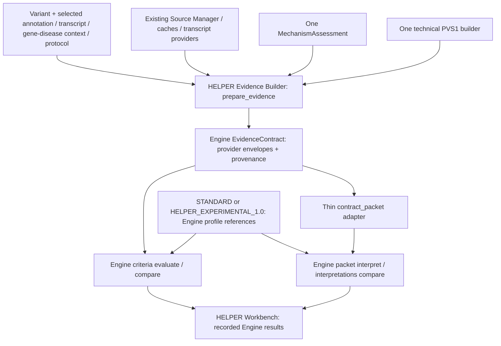

# Task 28R — ACMG/PVS1 simplified architecture

> Nota 2026-10-29: documento storico. La cache pubblica dei meccanismi e il relativo assessment locale sono conservati; Workbench, Coordinator/Assembler, contratti e valutazioni del servizio esterno descritti qui sono stati rimossi. Stato operativo: [HELPER_STRUCTURAL_CLEANUP.md](HELPER_STRUCTURAL_CLEANUP.md).

Data: 2026-10-28. Esito: **PARTIALLY_IMPLEMENTED**.

Refactoring conservativo nel solo repository HELPER. Verifica statica e controlli
sintattici locali; nessuna attestazione di validazione funzionale o clinica PVS1.
Le modifiche preesistenti degli altri task sono preservate.

## 1. Prima: flussi e sovrapposizioni

La lettura mirata dei riferimenti Task 22, 25, 27A e 28 e delle dipendenze Python/JS
ha individuato questa struttura:

```text
Task 22 API ------> Coordinator -> Assembler -> EvidenceContract -> criteria API
Classify API ----> ponte ------> Coordinator -> Assembler -> EvidenceContract
                    |                           |
                    +-- conversione packet <----+
                    +-- correzioni -> nuovo Assembler -> altra conversione packet
Coordinator -----> solo annotation stop_gained -> transformer nonsense
Altre conseguenze -> assessment EXTENSION + handoff tecnico DEFERRED
UI Task 22 ------> riepilogo PVS1 + ispettore PVS1 separato
UI Classify -----> riepilogo condiviso, tabella con diversa selezione dei campi
```

Esisteva già un solo modello `MechanismAssessment` e un solo transformer nonsense:
non sono stati eliminati modelli o decision tree inesistenti. Le duplicazioni
effettive erano la preparazione applicativa attorno al Coordinator, i passaggi
contract/packet, la gestione degli errori e la presentazione di PVS1. Il ponte
Classify richiedeva inoltre implicitamente la matrice completa diversamente da
Task 22. Le sorgenti e le decisioni scientifiche erano già separate.

## 2. Dopo: tre componenti logici

1. **HELPER Evidence Builder**: `acmg_evidence.prepare_evidence` è l'ingresso
   applicativo comune. Riusa Coordinator, Assembler, Source Manager, provider,
   resolver/cache dei meccanismi e il solo builder tecnico `acmg_pvs1.transform`.
   Restituisce il contratto validato dall'Engine, packet adattato, assessment,
   fonti, trasformazioni, informazioni mancanti e audit.
2. **ACMG Engine Criterion Evaluator**: riceve le stesse evidenze canoniche
   attraverso le operazioni già esistenti. Conserva applicabilità, NMD, decision
   tree, strength, VCEP, dipendenze e classificazione ACMG/Tavtigian. Nessuna
   modifica, lettura dei sorgenti esterni o esecuzione dell'Engine in questa sessione.
3. **HELPER Workbench**: presenta i risultati dell'Engine. La vista iniziale dei
   criteri contiene identificativo, stato, strength, motivo e warning. Meccanismo,
   confidence, scope, provenance, dati originali, soglie, trace, contributo e review
   restano consultabili nei dettagli e negli export esistenti.

Coordinator e Assembler sono implementazioni interne del primo componente,
non nuovi servizi o orchestratori. Nessun nuovo database o framework.

## 3. Flusso dati



## 4. Responsabilità e compatibilità

- `prepare_evidence` coordina una sola acquisizione automatica per invocazione,
  solleva gli errori del builder e gestisce i due formati di correzione già pubblici.
  Classify non prepara più assessment o osservazioni attraverso un proprio ramo.
- `contract_packet` copia variante, contesto, valori delle evidenze e dipendenze
  dal contratto validato. Non interpreta né ricostruisce il meccanismo.
- Le correzioni packet richiedono ancora fonte/versione/checksum, motivo e
  provenance MANUAL. La successiva validazione riusa gli envelope automatici
  invariati: `received_json`, trasformazioni, qualità e tolleranze non vengono
  sostituiti da una nuova serializzazione del solo valore. Nessuna nuova lettura
  delle fonti per questa validazione; i requirements finali sono richiesti all'Engine.
- Il contratto automatico prima delle correzioni packet e quello finale restano
  separati nell'audit Classify. Task 22 conserva workspace, correzioni ed envelope;
  se ci sono correzioni provider, il contratto risultante non viene etichettato
  impropriamente come automatico.
- La matrice completa resta un'aggiunta esplicita tramite i parametri cache
  Task 22; il default comune usa il percorso del Coordinator e CACHE_ONLY per
  l'assessment PVS1. La matrice risolta rimane nell'audit del builder anche senza
  l'EXTENSION aggiuntiva. Nessun record, mapping o snapshot viene eliminato.
- Il modello `MechanismAssessment`, la precedenza VCEP esplicito pertinente →
  altre assertions curate → inferenza disponibile → UNKNOWN e gli enum restano
  quelli esistenti. Il controllo dello scope e la serializzazione confidence sono
  ora metodi di quel modello. Association status, assertions, mapping e basis
  restano campi di compatibilità/audit, senza nuove dimensioni di policy.

Nessuna nuova API obbligatoria o migrazione dei formati persistenti. I nuovi
record incompleti usano l'esistente `PVS1Observation` con effetti vuoti e struttura
null; la classe annotata e il riferimento sono conservati nei dati originali.
La validazione strutturale e semantica autorevole resta nell'Engine: non è stato
creato un secondo modello locale di EvidenceContract o PVS1Observation.

## 5. File mantenuti, consolidati e wrapper

I percorsi Python seguenti sono sotto `helper_next/src/helper_next/`;
i JS sotto `helper_next/src/helper_variants/web/static/`.

| File | Intervento Task 28R |
| --- | --- |
| `core/acmg_evidence.py` | Ingresso comune, adapter packet, conservazione envelope, invocazione builder tecnico per tutte le classi riconosciute |
| `core/acmg_classification.py` | Ponte ridotto a protocollo, ingresso comune e trasporto delle operazioni classifier esistenti |
| `api/acmg_task22.py` | Stesso ingresso comune usato da Classify |
| `core/acmg_mechanism_assessment.py` | Unico assessment; scope e confidence wire format accanto al modello, algoritmo biologico preservato |
| `core/acmg_pvs1.py` | Unico builder tecnico; nonsense preservate, altre classi esplicitamente incomplete |
| `acmg-pvs1.js` | Campi dei risultati e renderer condivisi, due selezioni di policy, lettura dei soli metadati Engine |
| `acmg-task22.js` | Vista compatta, filtri su status/strength registrati, riuso renderer nell'ispettore, selezione policy senza flag deprecato |
| `acmg-workbench.js` | Stessa vista compatta e policy; profili/versioni e VCEP restano selezioni Engine |
| `core/acmg_task22.py` | Mantenuto: serializer, provider envelopes e version guard condivisi; nessuna modifica necessaria |
| `core/acmg_workbench.py`, `api/acmg.py` | Mantenuti: workspace, correzioni packet, review/export e operazioni pubbliche già collegate al ponte |

`EvidenceCoordinator.build` e `EvidenceAssembler` restano utilizzabili dai chiamanti
esistenti; `coordinated_packet` mantiene firma e formato restituito. `transform`
e `nonsense` mantengono le firme precedenti; ID, software e formula nonsense
rimangono quelli Task 25. `deferred_pvs1` rimane come piccolo audit compatibile
quando manca una conseguenza tecnica riconosciuta; non è un builder alternativo.
Nessun file eliminato o modulo monolitico introdotto.

Test predisposti/adattati, **non eseguiti**: `test_acmg_classification.py` per il
nuovo punto di sostituzione del Coordinator nei test; `test_acmg_pvs1.py` per i
casi annotation-only incompleti; `test_acmg_task28_browser.py` e
`test_acmg_browser.py` per le etichette e le colonne aggiornate.

## 6. Duplicazioni effettivamente rimosse

- Controllo degli errori del builder ripetuto in Task 22 e nel ponte Classify.
- Conversioni manuali ripetute di EvidenceContract verso snapshot packet.
- Riassemblaggio e gestione delle correzioni automatiche nel ponte classifier.
- Serializzazione confidence e controllo dello scope separati dal modello assessment.
- Dettagli PVS1 ricostruiti separatamente nell'ispettore Task 22.
- Scelta divergente dei campi di riepilogo PVS1 nelle due UI; i campi applicati
  sono letti da `pvs1Result`, senza derivarli dalla confidence.
- Uso frontend del flag deprecato per presentare modalità di contribuzione diverse.

Restano intenzionalmente distinti i contratti delle operazioni Engine e i due
formati pubblici di correzione; unificarli richiederebbe una modifica API non necessaria.

## 7. Classi PVS1 e limiti reali

| Classe | Preparazione automatica attuale | Dati mancanti / limite |
| --- | --- | --- |
| Stop-gain/nonsense | Ricostruzione Task 25 invariata: sostituzioni a lunghezza uguale, REF/CDS verificati, codone/PTC e giunzioni | Riferimento esatto qualificato, gene/trascritto/versione, rilevanza clinica/esonica, rescue e revisione; nessuna nuova verifica funzionale Task 28R |
| Frameshift | Riconoscimento annotation, stesso provider e riferimento conservato, osservazione INCOMPLETE | Mappatura indel qualificata, CDS alterato/frame e stop downstream non implementati nel builder; nessun PTC ricavato da HGVS |
| Splice canoniche | Riconoscimento donor/acceptor, riferimento conservato, osservazione INCOMPLETE | Evento splice/RNA qualificato e conseguenza sul trascritto/frame/PTC; non si afferma exon skipping |
| Splice non canoniche | Termini splice region/donor region/5th base/polypyrimidine e dati originali conservati; INCOMPLETE | Una predizione non dimostra l'evento; nessun nuovo predittore. Altre annotazioni richiedono evidenza pertinente strutturata nel percorso di correzione esistente |
| Start-loss | Riconoscimento `start_lost`, riferimento conservato, INCOMPLETE | Effetto sull'inizio, inizio alternativo/reinizio e contesto trascrizionale qualificati |
| Delezioni/duplicazioni esoniche | Termini exon loss/transcript ablation/amplification/copy number conservati; INCOMPLETE | Breakpoint, copie, orientamento e struttura trascrizionale qualificati; varianti simboliche non normalizzabili possono essere bloccate prima del builder |

Tutte le classi riconosciute passano dalla stessa interfaccia. Per le classi diverse
dalle nonsense, `transcript_effects=[]`, `structural=null`, `calculation=null` e
motivi specifici espliciti impediscono di presentare fatti tecnici inventati.
Anche riferimento assente o identità discordante producono un motivo esplicito.
Riconoscere l'annotation e registrare le lacune **non equivale a copertura tecnica
completa**. Non vengono calcolati NMD, strength o decision tree in HELPER.

## 8. Engine 1.1 e policy

L'Engine non è stato interrogato: ultimo stato documentato, non riverificato,
Engine operativo 1.0 con integrazione 1.1 ancora esterna/incompleta. HELPER mantiene
il guard preventivo dello schema e non elimina confidence per retrocedere a 1.0.
Le osservazioni legacy senza assessment mantengono la serializzazione 1.0.
Gli endpoint criteria evaluate/compare e packet interpret/interpretations compare
rimangono invariati, con verifica dei rispettivi schemi. Una classificazione senza
i metadati PVS1 richiesti resta un fallimento d'integrazione archiviato.

Le sole modalità UI sono STANDARD e HELPER_EXPERIMENTAL_1.0. Task 22 trasmette il
riferimento scientific_profile; Classify trasmette il profilo base/versione nella
configuration, preservando le specializzazioni VCEP. Se manca un profilo Engine
compatibile, HELPER blocca la selezione/esecuzione dipendente; con più versioni
richiede una scelta esplicita. Non sostituisce una policy con regole locali.
I vecchi profili restano artefatti Engine; HELPER non ne deduce la semantica da
flag deprecati né può correggere l'eventuale comportamento storico del motore.

Applicazione di INFERRED/DISPUTED disease-specific con warning e strength,
EXPLORATORY gene-level senza punti, inattività per non-LoF/UNKNOWN e precedenza
degli override VCEP appartengono all'Engine e restano **da verificare lì**.
Nessuna assertion VCEP è inventata: gli adapter attuali non forniscono ancora
lo statement biologico approvato con provenance richiesto dall'assessment.

## 9. Verifiche della sessione e necessarie

Eseguiti soltanto parsing AST dei file Python modificati, controllo sintattico
dei tre moduli JavaScript modificati e controllo statico delle dipendenze/whitespace.
Questi controlli non eseguono né importano l'applicazione e non validano la scienza.

Prima di considerare operativa l'integrazione occorrono verifiche autorizzate:

1. Parità delle evidenze canoniche Task 22/Classify a parità di input e correzioni.
2. Preservazione integrale degli envelope automatici dopo correzioni packet,
   requisiti aggiornati e replay/audit, incluse dipendenze da evidenze sostituite.
3. Accettazione Engine 1.1 dei payload completi/incompleti e dei due trasporti.
4. Esiti Engine per STANDARD/sperimentale, INFERRED/DISPUTED con LoF supportato,
   EXPLORATORY senza contributo, non-LoF/UNKNOWN e override VCEP applicabili.
5. Fonti VCEP biologiche reali con provenance e qualificazione dello scope.
6. UI compatta/dettagli, warning, filtri e scelta di profili/versioni.
7. Prima di estendere i fatti tecnici: casi positivi/negativi e strand per
   frameshift, splice, start-loss e CNV con riferimenti ed eventi qualificati.

Nessun pytest, suite completa, test HTTP/ASGI o browser, server, benchmark,
sincronizzazione, popolamento, comando fuori sandbox, escalation, commit o push.
Nessun test precedentemente bloccato è stato rieseguito.

## 10. Attività residue ed esito

La consolidazione applicativa, il builder comune con lacune esplicite e la UI
semplificata sono implementati nel codice. Restano parziali la preparazione
tecnica automatica delle classi diverse dalle nonsense e la verifica funzionale.
La disponibilità della policy sperimentale conforme, il consumo effettivo
dell'assessment nei classificatori e la compatibilità operativa Engine 1.1 sono
blocchi esterni a questa sessione. Cache popolate, Ontology Mapping Registry,
Source Manager, provider trascrizionali, database campioni, Nextflow e workflow
NGS non sono modificati.

**PARTIALLY_IMPLEMENTED** — nessuna dichiarazione VALIDATED o validazione clinica PVS1.
